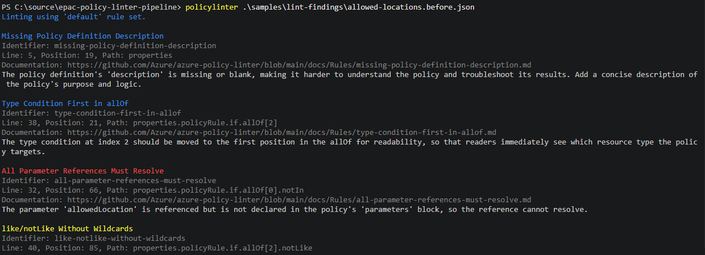
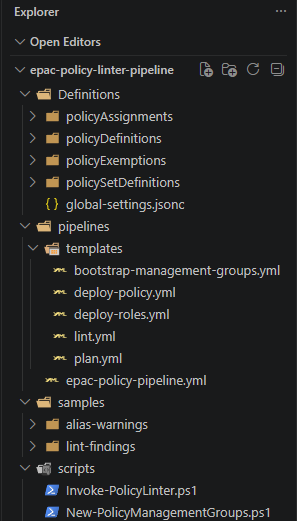
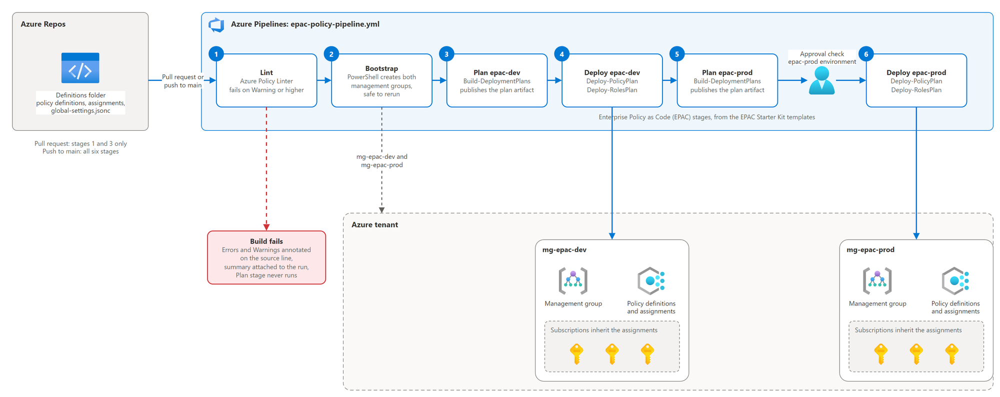

Azure accepts a policy definition long before it's a good one. You can make a definition with a hard-coded <code>Deny</code>, a <code>like</code> operator that was meant to be <code>equals</code>, or a field alias that doesn't exist in older API versions deploys without a notice. Then, you find out later, when a developer's deployment is blocked for the wrong reason, or when compliance shows green while enforcement quietly does nothing.

That knowledge is spread across resource provider documentation, or simply in people's minds. Or is it?

Azure Policy Linter collects it all together into a command-line tool. Version 0.8.0 ships 42 rules that inspect a single policy definition and report findings at three severities, each linked to a documentation page that explains the risk and the fix. It runs offline, reads the same JSON you commit to source control, and writes JSON for CI systems.

In this article, you apply the same DevOps principles to Azure Policy that you already apply to your application code. You first start by linting every change, delivering it through a DevOps pipeline, and promoting it from development to production.
<h2 id="prerequisites">Prerequisites</h2>
Before you begin this tutorial, there are a couple of prerequisites:
<ul><li>An Azure subscription and permission to create management groups</li><li>An Azure DevOps project with permission to create pipelines, service connections, and environments</li><li><a href="https://dotnet.microsoft.com/download">.NET SDK</a> 10.0 or later to run the linter locally</li><li>Working knowledge of EPAC</li></ul>
The <a href="https://azure.github.io/enterprise-azure-policy-as-code/start-implementing/">EPAC getting started guide</a>&nbsp;covers the fundamental knowledge, and this article doesn't repeat it. This tutorial will also provision some resources and assumes you clone the sample repository:
<pre><code class="language-powershell">git clone https://github.com/Gijsreyn/random-tools-gijs
cd random-tools-gijs/azure-devops/epac-policy-linter-pipeline</code></pre>
The code blocks in this article are condensed to the lines that matter. The repository holds the complete pipeline, templates, scripts, and sample definitions, and every path in this article is relative to its root.
<h2 id="how-the-linter-reports-findings">How the linter reports findings</h2>
Every finding has one of three severities. The linter's own design guide defines them like this:
<table>
<thead>
<tr>
<th>Severity</th>
<th>Meaning</th>
</tr>
</thead>
<tbody>
<tr>
<td>Error</td>
<td>The policy fails to deploy, fails at evaluation time, or behaves significantly differently from what the author intended.</td>
</tr>
<tr>
<td>Warning</td>
<td>The policy behaves unexpectedly in some cases: logic gaps, missed edge cases, resource type gotchas, misused operators. Also used for high-value best practices such as parameterizing the effect.</td>
</tr>
<tr>
<td>Informational</td>
<td>Worth knowing, not worth a warning. Ignoring it has little or no effect on the policy's behavior.</td>
</tr>
</tbody>
</table>

Two details matter for a pipeline. First, the linter processes up to 1,000 files per invocation and writes one JSON document with <code>--output</code>, keyed by input path. Second, its exit code reports whether the tool could run, not whether your policies are healthy. A policy with ten <em>Error</em> findings still exits with 0. That's deliberate, and it's why a later section wraps the linter in a PowerShell script that decides pass or fail.
<blockquote>

[!NOTE] 
The linter inspects policy definitions only. Policy set definitions, assignments, and exemptions are out of scope, and so are data-plane policies and effect details such as <code>deployIfNotExists</code> templates. EPAC's <code>Build-DeploymentPlans</code> validates the rest of your <code>Definitions</code> folder.

</blockquote>
<h2 id="run-the-linter-locally">Run the linter locally</h2>
The Azure Policy Linter CLI comes as a global .NET tool, so you can install it with the .NET CLI. Then you can point it to a flawed policy in the sample repository:
<pre><code class="language-powershell">dotnet tool install --global Microsoft.Azure.Policy.PolicyLinter.Cli
policylinter ./samples/lint-findings/allowed-locations.before.json</code></pre><figure class="kg-card kg-image-card kg-card-hascaption"><figcaption>Figure 1: Linting report findings</figcaption></figure>
The policy is a custom allowed-locations rule, as someone might write it on a first attempt. Here are the relevant parts:
<pre><code class="language-json">"parameters": {
    "allowedLocations": {
        "type": "Array",
        "defaultValue": [ "westeurope", "northeurope" ]
    }
},
"policyRule": {
    "if": {
        "allOf": [
            { "field": "location", "notIn": "[parameters('allowedLocation')]" },
            { "field": "location", "notEquals": "global" },
            { "field": "type", "notLike": "Microsoft.Resources/subscriptions/resourceGroups" }
        ]
    },
    "then": {
        "effect": "Deny"
    }
}</code></pre>
The linter reports five findings. The output is abbreviated here to the three that change how the policy behaves:
<pre><code class="language-plaintext">All Parameter References Must Resolve
Identifier: all-parameter-references-must-resolve
Line: 32, Position: 66, Path: properties.policyRule.if.allOf[0].notIn
The parameter 'allowedLocation' is referenced but is not declared in the policy's 'parameters' block, so the reference cannot resolve.&#10;
like/notLike Without Wildcards
Identifier: like-notlike-without-wildcards
Line: 40, Position: 85, Path: properties.policyRule.if.allOf[2].notLike
The condition uses the 'notLike' operator with value 'Microsoft.Resources/subscriptions/resourceGroups' which contains no wildcard (*). Without a wildcard it behaves identically to 'notEquals'; use 'notEquals' to express exact-match intent.&#10;
Hard-Coded Policy Enforcement Effect
Identifier: hard-coded-policy-enforcement-effect
Line: 45, Position: 32, Path: properties.policyRule.then.effect
The policy effect 'Deny' is hard-coded, so assignments cannot select a non-enforcement effect. Add a string 'effect' parameter with defaultValue 'audit' and allowedValues containing 'audit', 'Deny', 'disabled', then set the policy effect to "[parameters('effect')]".</code></pre>
The first finding is an Error: <code>allowedLocation</code> is a typo for <code>allowedLocations</code>, and the definition fails when you deploy it. The other two are Warnings. The <code>notLike</code> condition behaves exactly like <code>notEquals</code>, so the operator only misleads the next person who reads the rule. The hard-coded <code>Deny</code> means every assignment enforces it from day one, with no way to audit first. The remaining two findings are Informational: the description is missing, and the <code>type</code> condition isn't first in the <code>allOf</code>.

Each finding carries a line and column. That's what lets the pipeline annotations in a later section land on the right line of the file.  The corrected definition at <code>Definitions/policyDefinitions/General/allowed-locations.json</code> fixes all five. Its rule looks like this:
<pre><code class="language-json">"policyRule": {
    "if": {
        "allOf": [
            { "field": "type", "notEquals": "Microsoft.Resources/subscriptions/resourceGroups" },
            { "field": "location", "notIn": "[parameters('allowedLocations')]" },
            { "field": "location", "notEquals": "global" }
        ]
    },
    "then": {
        "effect": "[parameters('effect')]"
    }
}</code></pre>
The <code>effect</code> parameter defaults to <code>Audit</code> with <code>Audit</code>, <code>Deny</code>, and <code>Disabled</code> as allowed values. That's the pattern the linter's rule documentation recommends, and the pattern EPAC's own guidance asks for.
<h2 id="turn-findings-into-a-pass-or-fail">Turn findings into a pass or fail</h2>
Now that you ran the linter locally, you can see that the linter leaves something to you. That's where those annotations come in, and the wrapper at <code>scripts/Invoke-PolicyLinter.ps1</code> does it all into one:
<ol><li>Finds every <code>.json</code> and <code>.jsonc</code> file under <code>Definitions/policyDefinitions</code>. The linter parses comments and trailing commas, so EPAC's `.jsonc` files need no preprocessing.</li><li>Installs the tool if <code>policylinter</code> isn't on the <code>PATH</code>, with an optional pinned version.</li><li>Runs the linter in batches of 200 files with <code>--output</code>, then merges the JSON.</li><li>Prints the findings. When the <code>TF_BUILD</code> environment variable shows it's on an Azure Pipelines agent, it also writes <code>##vso[task.logissue]</code> logging commands, so Errors and Warnings appear in the run summary and link to the source line.</li><li>Writes a Markdown summary and attaches it to the run with <code>##vso[task.uploadsummary]</code>.</li><li>Exits with 1 when any finding is at or above the <code>-FailOn</code> severity. The default is <code>Warning</code>.</li></ol>
The core of the script, condensed:
<pre><code class="language-powershell">&amp; policylinter @files --output $resultPath
if ($LASTEXITCODE -ne 0) { throw 'policylinter could not complete.' }   # a tool failure, not a finding&#10;
$results = Get-Content $resultPath -Raw | ConvertFrom-Json -AsHashtable
$findings = foreach ($file in $results.Keys) {
    foreach ($entry in @($results[$file])) {
        [pscustomobject]@{
            Severity       = [string] $entry.severity
            RuleIdentifier = $entry.ruleIdentifier
            File           = [IO.Path]::GetRelativePath($sourcesRoot, $file)
            Line           = $entry.lineNumber
            Column         = $entry.linePosition
            Description    = $entry.description
        }
    }
}&#10;
foreach ($f in $findings | Where-Object { $_.Severity -in 'Error', 'Warning' }) {
    $type = if ($f.Severity -eq 'Error') { 'error' } else { 'warning' }
    Write-Host "##vso[task.logissue type=$type;sourcepath=$($f.File);linenumber=$($f.Line);columnnumber=$($f.Column);code=$($f.RuleIdentifier)]$($f.Description)"
}&#10;
$severityRank = @{ Informational = 1; Warning = 2; Error = 3 }
$blocking = $findings | Where-Object { $severityRank[$_.Severity] -ge $severityRank[$FailOn] }
if ($blocking) { exit 1 }</code></pre>
Two parameters deserve a mention. <code>-FailOn</code> sets the threshold: <code>Error</code> lets warnings through as annotations, <code>Informational</code> fails on everything, and <code>None</code> only reports. <code>-ExcludeRule</code> takes rule identifiers whose findings are still printed but never fail the run, for findings you have reviewed and accepted.
<blockquote>

[!TIP] 
You need <code>-ExcludeRule</code> sooner than you might expect. The storage policy at <code>samples/alias-warnings/storage-https-only.json</code> is well formed, yet it gets a Warning from <code>field-alias-unavailable-in-old-api-versions</code>: the <code>supportsHttpsTrafficOnly</code> property doesn't exist in storage API versions from 2015 and 2016, so a request on one of those versions resolves the alias to an empty value.

</blockquote>
<h2 id="set-up-the-repository-folder-structure">Set up the (repository) folder structure</h2>
The sample repository folder structure follows the EPAC convention of a <code>Definitions</code> root. The pipeline and scripts live beside it, never inside it. This way, EPAC doesn't mistake them for policy files.
<figure class="kg-card kg-image-card kg-card-hascaption"><figcaption>Figure 2: Folder structure</figcaption></figure>
It's good to know that in this example, the <code>global-settings.jsonc</code> declares two EPAC environments. Each one points to the management group the pipeline creates:
<pre><code class="language-jsonc">"pacEnvironments": [
    {
        "pacSelector": "epac-dev",
        "cloud": "AzureCloud",
        "tenantId": "00000000-0000-0000-0000-000000000000",
        "deploymentRootScope": "/providers/Microsoft.Management/managementGroups/mg-epac-dev",
        "desiredState": { "strategy": "full", "keepDfcSecurityAssignments": false, "doNotDisableDeprecatedPolicies": false },
        "managedIdentityLocation": "westeurope"
    },
    {
        "pacSelector": "epac-prod",
        // same shape, rooted at mg-epac-prod
    }
]</code></pre>
Replace both <code>tenantId</code> values with your tenant ID and generate a new <code>pacOwnerId</code> with <code>(New-Guid).Guid</code>. EPAC uses the owner ID to tell its own deployments apart from everything else at the scope, so never copy one between repositories.

The assignment file assigns both definitions at the root of each environment. The <code>scope</code> map is keyed by <code>pacSelector</code>, so one file drives dev and prod:
<pre><code class="language-jsonc">"scope": {
    "epac-dev": [ "/providers/Microsoft.Management/managementGroups/mg-epac-dev" ],
    "epac-prod": [ "/providers/Microsoft.Management/managementGroups/mg-epac-prod" ]
}</code></pre><blockquote>

[!NOTE] 
EPAC's documentation names its production environment <code>tenant</code> rather than <code>prod</code>, to keep EPAC environments distinct from your workload environments. This sample uses <code>epac-prod</code> because the two management groups are the point of the exercise. In a real tenant, the production EPAC environment is usually your existing intermediate root management group, and only the development one is new.

</blockquote>
<h2 id="create-the-management-groups-with-powershell">Create the management groups with PowerShell</h2>
Time to create the management groups. <code>scripts/New-PolicyManagementGroups.ps1</code> creates <code>mg-epac-dev</code> and <code>mg-epac-prod</code> under a parent that you choose. With no parent specified, it uses the tenant root group, whose ID is the tenant ID. The script is idempotent: existing groups are reported and left alone, so the pipeline can run it on every build.  The core logic per management group:
<pre><code class="language-powershell">$existing = Get-ManagementGroupOrNull -Name $target.Name   # wraps Get-AzManagementGroup, returns $null on NotFound
if ($existing) {
    [pscustomobject]@{ Name = $existing.Name; Id = $existing.Id; Status = 'Exists' }
    continue
}&#10;
if ($PSCmdlet.ShouldProcess("$($target.Name) under $parentResourceId", 'Create management group')) {
    New-AzManagementGroup -GroupName $target.Name -DisplayName $target.DisplayName -ParentId $parentResourceId
    Wait-ManagementGroup -Name $target.Name -Timeout $TimeoutSeconds   # poll until it reads back
}</code></pre>
The wait loop matters. A freshly created management group can take a short while before Azure Policy accepts it as a scope, and the next stage of the pipeline deploys definitions to it. Because the script supports <code>-WhatIf</code>, you can preview it from your own machine:
<pre><code class="language-powershell">Connect-AzAccount
./scripts/New-PolicyManagementGroups.ps1 -WhatIf</code></pre><blockquote>

[!NOTE] 
The identity that runs the script needs the Management Group Contributor role on the parent management group.

</blockquote>
<h2 id="build-the-pipeline">Build the pipeline</h2>
<code>pipelines/epac-policy-pipeline.yml</code> runs six stages in order:
<figure class="kg-card kg-image-card kg-card-hascaption"><figcaption>Figure 3: EPAC with Azure Policy Linter pipeline</figcaption></figure>
Pull requests run only Lint and Plan epac-dev. Pushes to <code>main</code> run everything. The plan and deploy templates follow the EPAC Starter Kit's Azure DevOps templates: <code>Build-DeploymentPlans -DevOpsType ado</code> publishes the plans as an artifact and sets the <code>deployPolicyChanges</code> and <code>deployRoleChanges</code> output variables, and the deploy stages skip themselves when both are <code>no</code>.

The Lint stage is the new part. Its template installs the .NET SDK and runs the wrapper:
<pre><code class="language-yaml">steps:
  - checkout: self&#10;
  - task: UseDotNet@2
    displayName: Use .NET SDK 10.0
    inputs:
      packageType: sdk
      version: 10.0.x&#10;
  - pwsh: |
      ./scripts/Invoke-PolicyLinter.ps1 `
          -Path '$(Build.SourcesDirectory)/Definitions/policyDefinitions' `
          -FailOn '${{ parameters.failOn }}' `
          -OutputPath '$(Build.ArtifactStagingDirectory)/lint/policy-lint-results.json'
    displayName: Run Azure Policy Linter&#10;
  - publish: $(Build.ArtifactStagingDirectory)/lint
    artifact: policy-lint-results
    condition: succeededOrFailed()</code></pre>
The pipeline exposes the threshold as a runtime parameter, <code>lintFailOn</code>, allowing you to rerun a build with <code>Error</code> or <code>None</code> without editing YAML. A second parameter, <code>lintExcludeRules</code>, passes a comma-separated list of rule identifiers to <code>-ExcludeRule</code>.
<h2 id="running-the-pipeline">Running the pipeline</h2>
The pipeline references four Azure Resource Manager service connections by name. Create them with the roles below, following EPAC's <a href="https://azure.github.io/enterprise-azure-policy-as-code/ci-cd-app-registrations/">service principal guidance</a>. For a lab, one service principal with all three roles at the parent management group can stand behind all four names.
<table>
<thead>
<tr>
<th>Pipeline variable</th>
<th>Role</th>
<th>Scope</th>
</tr>
</thead>
<tbody>
<tr>
<td><code>bootstrapServiceConnection</code></td>
<td>Management Group Contributor</td>
<td>Parent management group</td>
</tr>
<tr>
<td><code>planServiceConnection</code></td>
<td>Reader</td>
<td>Tenant root group</td>
</tr>
<tr>
<td><code>devServiceConnection</code></td>
<td>Resource Policy Contributor, Role Based Access Control Administrator</td>
<td><code>mg-epac-dev</code></td>
</tr>
<tr>
<td><code>prodServiceConnection</code></td>
<td>Resource Policy Contributor, Role Based Access Control Administrator</td>
<td><code>mg-epac-prod</code></td>
</tr>
</tbody>
</table>

Then run it end to end:
<ol>
<li>In Azure DevOps, create a pipeline from <code>pipelines/epac-policy-pipeline.yml</code> and run it on <code>main</code>. The Lint stage passes, the Bootstrap stage creates both management groups, and EPAC deploys the two definitions and their assignments to <code>mg-epac-dev</code>, then to <code>mg-epac-prod</code>. The deploy stages use deployment jobs, so this first run also creates the Azure DevOps environments <code>epac-dev</code> and <code>epac-prod</code>.</li>
<li>(Optional) Put a person in front of production. Select <strong>Pipelines</strong> &gt; <strong>Environments</strong> &gt; <strong>epac-prod</strong> &gt; <strong>Approvals and checks</strong>, and add an approval. Without it, a push to <code>main</code> flows to production as soon as <code>epac-dev</code> succeeds, which is fine for a lab and not for a tenant you share.</li>
<li>Create a branch, copy <code>samples/lint-findings/allowed-locations.before.json</code> over <code>Definitions/policyDefinitions/General/allowed-locations.json</code>, and open a pull request. The Lint stage fails with one error and two warnings. Each one appears in the run summary with a link to the file and line, and the <strong>Extensions</strong> tab shows the Markdown table of findings. The Plan stage never runs.</li>
<li>Restore the corrected file, push, and watch the same pull request go green. Merge it. The run on <code>main</code> deploys to <code>epac-dev</code>, then to <code>epac-prod</code>, pausing there for approval if you added one.</li>
</ol>
<h2 id="clean-up-resources">Clean up resources</h2>
Delete the two management groups when you're done. Azure removes the policy assignments and definitions EPAC deployed to them. Move any subscriptions out first, because a management group with children can't be deleted.

<pre><code class="language-powershell">Remove-AzManagementGroup -GroupName mg-epac-dev
Remove-AzManagementGroup -GroupName mg-epac-prod
</code></pre>
<h2 id="summary">Summary</h2>
You now run Azure Policy the way you run code. Every pull request is linted, and a finding at Warning or higher fails the build with the file and line attached. Changes that pass are delivered by EPAC to a development management group first and to production second, behind an approval if you added one. The linter judges the definition, EPAC deploys it, and the only custom code is one PowerShell script whose two decisions, the failing severity and the accepted rules, are pipeline parameters.

