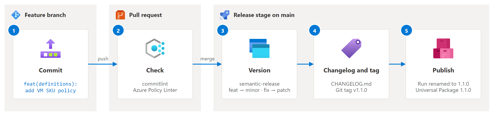
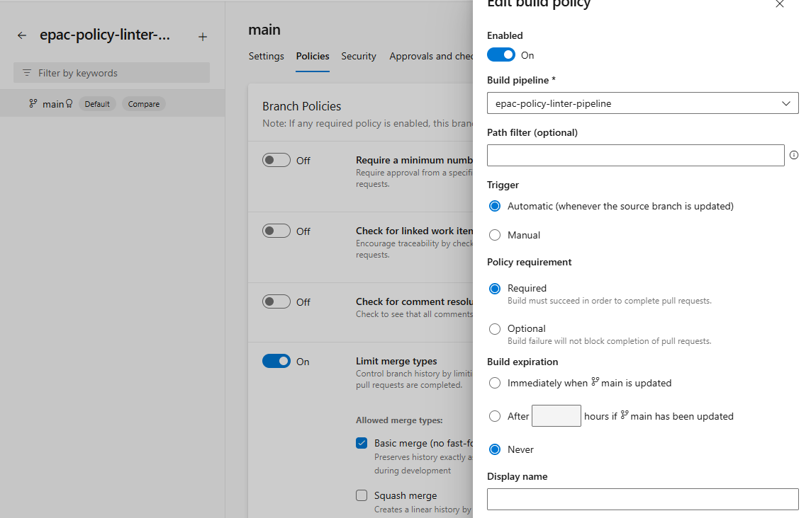
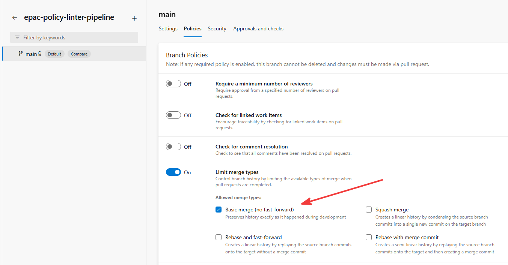
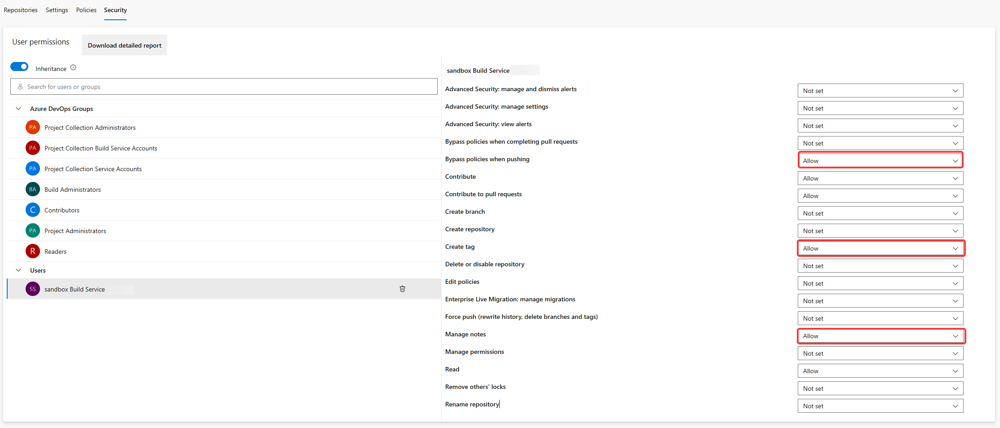
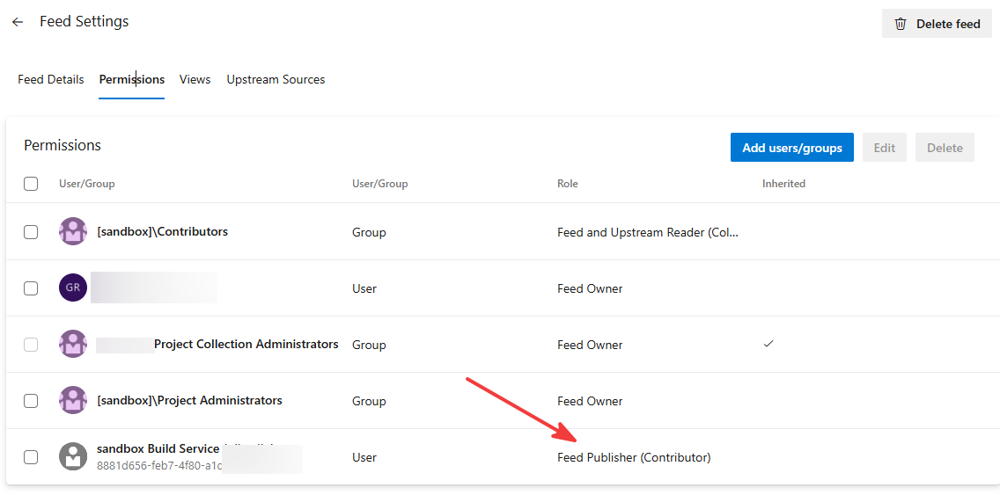
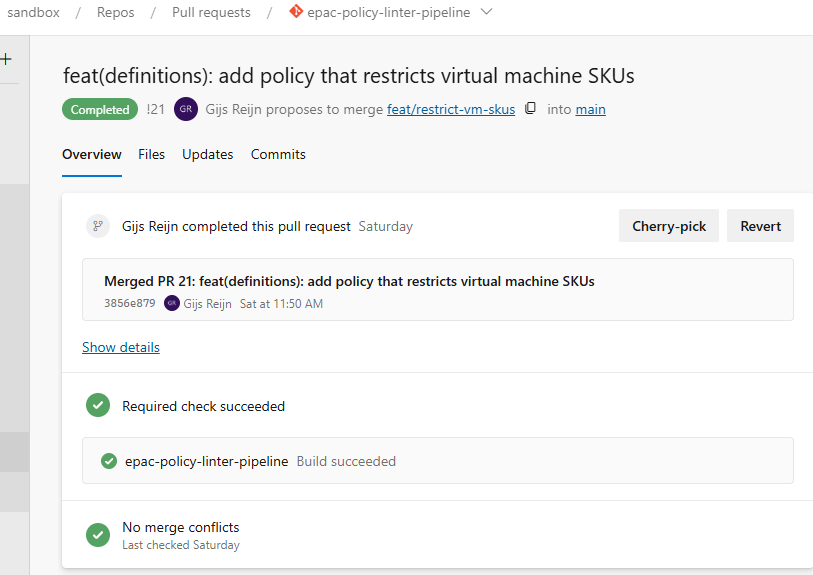
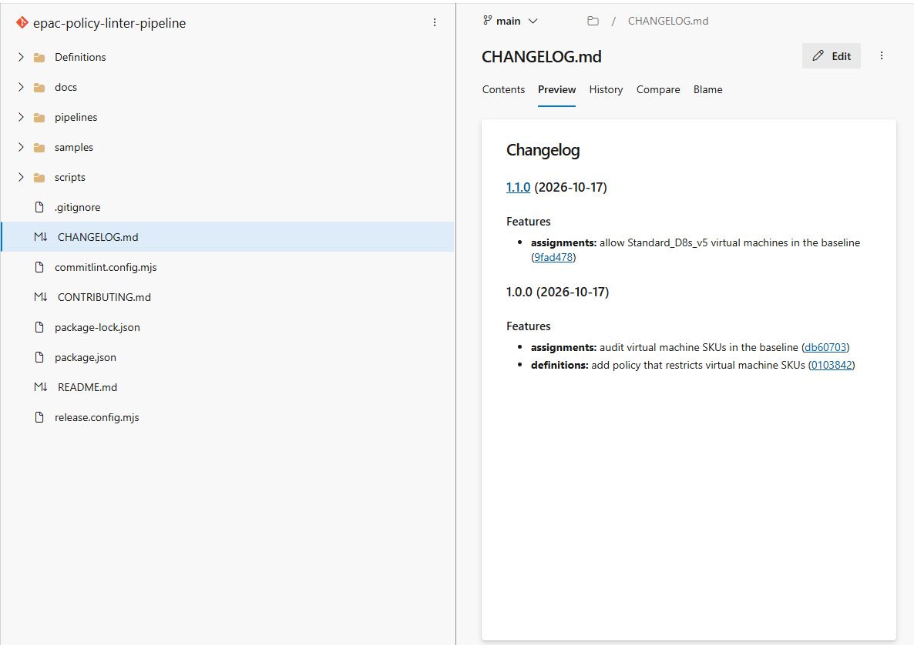
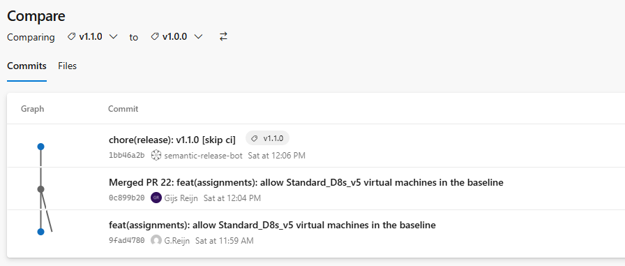

For a good part of my current career, I supported the platform engineering members who manage the Azure cloud. However, I switched departments, and I'm not in that seat anymore on use cases that help the platform. Yet I keep coming back to some stuff. Stuff that is satisfying after you build a pipeline that does the boring work for you.

In my <a href="/how-to-lint-azure-policy-definitions-in-azure-devops-with-epac-and-azure-policy-linter/">previous post</a>, you built a pipeline that lints every Azure Policy definition with the Azure Policy Linter before Enterprise Policy as Code (EPAC) deploys it. It answered the question I was looking for: <em>Is this policy any good</em>?

But it left one open. Which version of your policies is running in production right now? And what might have changed since last Tuesday? Git history has the answer somewhere. Between commits called "Test", "Trigger," and "Update pipeline". Or does it?

I wanted to extend the pipeline with those questions answered. So, in this guide, if you want to follow along, you add <a href="https://semantic-release.gitbook.io/">semantic-release</a> to the pipeline. Every merge to <code>main</code> that adds or fixes a policy becomes a version number, a changelog entry, a Git tag, and an immutable package in Azure Artifacts. You never pick a version yourself.

In this article, you:
<ul>
<li>Check every commit message in a pull request against Conventional Commits</li>
<li>Configure semantic-release for Azure Repos</li>
<li>Add a Release stage that versions, tags and packages your policies</li>
<li>Give the pipeline the permissions it needs to push and publish</li>
<li>Release <code>1.0.0</code> and <code>1.1.0</code> with a new policy that restricts virtual machine SKUs</li>
</ul>
<h2 id="how-it-works">How it works</h2>

The version comes from your commit messages. You write them in the <a href="https://www.conventionalcommits.org/en/v1.0.0/">Conventional Commits</a> format, and the pipeline does the rest:

<ol>
<li>You commit with a message such as <code>feat(definitions): add policy that restricts virtual machine SKUs</code>.</li>
<li>On the pull request, <a href="https://commitlint.js.org/">commitlint</a> checks every commit message, and the Azure Policy Linter checks the policies.</li>
<li>After the merge, semantic-release reads the commits since the last release tag and works out the next version.</li>
<li>It writes <code>CHANGELOG.md</code>, tags the commit and hands the version to the pipeline.</li>
<li>The pipeline renames the run to that version and publishes <code>Definitions/</code>, <code>docs/</code> and <code>CHANGELOG.md</code> as a Universal Package with the same version.</li>
</ol>

The commit type decides the version:

<table>
<thead>
<tr>
<th>Type</th>
<th>Use it for</th>
<th>Next version</th>
</tr>
</thead>
<tbody>
<tr>
<td><code>feat</code></td>
<td>A new policy, policy set, assignment or optional parameter</td>
<td>Minor: 1.4.0 → 1.5.0</td>
</tr>
<tr>
<td><code>fix</code></td>
<td>A policy that doesn't do what it was meant to, such as a wrong alias or condition</td>
<td>Patch: 1.4.0 → 1.4.1</td>
</tr>
<tr>
<td><code>docs</code>, <code>ci</code>, <code>chore</code>, <code>refactor</code>, ...</td>
<td>Anything that doesn't change what is deployed</td>
<td>No release</td>
</tr>
<tr>
<td>Any type with <code>!</code>, or a <code>BREAKING CHANGE:</code> footer</td>
<td>A change someone has to act on</td>
<td>Major: 1.4.0 → 2.0.0</td>
</tr>
</tbody>
</table>

What counts as breaking for a policy? Semantic versioning was made for APIs, not for guardrails. Here's the rule I use: a change is breaking when a deployment that works today could fail tomorrow, or when someone has to update an assignment before it still works. For example:

<ul>
<li>switching an effect to <code>Deny</code>, <code>DeployIfNotExists</code> or <code>Modify</code></li>
<li>removing or renaming a policy. EPAC deletes and recreates it under the new name, which drops its compliance history.</li>
<li>removing a parameter or an allowed value, or adding a parameter without a default</li>
<li>narrowing what a policy allows, such as removing a location from <code>allowedLocations</code></li>
</ul>

Such a sample you can easily keep in <code>CONTRIBUTING.md</code> file, so contributors don't have to guess.

<h2 id="prerequisites">Prerequisites</h2>
Now that you know about semantic-release, there are a couple of prerequisites if you want to follow along:
<ul>
<li>The sample from the previous post. Copy the <a href="https://github.com/Gijsreyn/random-tools-gijs"><code>azure-devops/epac-policy-linter-pipeline</code></a> folder into an Azure Repos repository of its own. This guide assumes that folder is the repository root.</li>
<li>An Azure DevOps project with Azure Repos and Azure Artifacts.</li>
<li>Permission to edit repository security, branch policies and feed settings.</li>
<li>Optional: Node.js 22.22.2 or later to check commit messages on your machine before you push.</li>
</ul>

If you've them in-place, let's get started with adding the release tooling itself.
<h2 id="add-the-release-tooling">Add the release tooling</h2>
semantic-release and commitlint are Node.js tools. That doesn't make the repository a Node.js project: npm only installs the two tools, and nothing gets published to npm.

First, let's pin the tools in <code>package.json</code>. Add a `package.json` to the repository root:
<pre><code class="language-json">{
  "name": "epac-policy-linter-pipeline",
  "private": true,
  "description": "Release tooling for the EPAC policy repository. Not a Node.js package: npm only installs semantic-release and commitlint.",
  "engines": {
    "node": "^22.22.2 || &gt;=24.15.0"
  },
  "devDependencies": {
    "@commitlint/cli": "21.2.3",
    "@commitlint/config-conventional": "21.2.3",
    "@semantic-release/changelog": "7.0.0",
    "@semantic-release/commit-analyzer": "13.0.1",
    "@semantic-release/exec": "7.1.0",
    "@semantic-release/git": "11.0.1",
    "@semantic-release/release-notes-generator": "14.1.1",
    "conventional-changelog-conventionalcommits": "9.3.1",
    "semantic-release": "25.0.9"
  }
}</code></pre>
Run <code>npm install</code> once to create <code>package-lock.json</code>, and commit both files. Add <code>node_modules/</code> to <code>.gitignore</code>. The versions are exact on purpose: the pipeline installs with <code>npm ci</code>, so every run uses the same tools, and a new release of a plugin can't change how your changelog looks overnight.

Time to check out the commit messages against Conventional Commits. Create <code>commitlint.config.mjs</code>:
<pre><code class="language-javascript">export default {
    extends: ['@commitlint/config-conventional'],
};</code></pre>
You can now check a message before you commit it:

<pre><code class="language-powershell">npm ci
'feat(definitions): add a storage policy' | npx commitlint
</code></pre>

You can now configure semantic-release by creating <code>release.config.mjs</code>:
<pre><code class="language-javascript">export default {
    branches: ['main'],
    plugins: [
        ['@semantic-release/commit-analyzer', { preset: 'conventionalcommits' }],
        [
            '@semantic-release/release-notes-generator',
            {
                preset: 'conventionalcommits',
                // The default compare link uses GitHub's /compare/a...b, which Azure Repos doesn't serve.
                presetConfig: {
                    compareUrlFormat:
                        '{{host}}/{{owner}}/{{repository}}/branchCompare?baseVersion=GT{{previousTag}}&amp;targetVersion=GT{{currentTag}}',
                },
            },
        ],
        ['@semantic-release/changelog', { changelogFile: 'CHANGELOG.md', changelogTitle: '# Changelog' }],
        [
            '@semantic-release/git',
            {
                assets: ['CHANGELOG.md'],
                // [skip ci] stops this commit from starting another pipeline run.
                message: 'chore(release): ${nextRelease.gitTag} [skip ci]\n\n${nextRelease.notes}',
            },
        ],
        [
            '@semantic-release/exec',
            {
                // Hands the version to the pipeline once the tag is pushed.
                publishCmd: 'printf "##%s[task.setvariable variable=version;isOutput=true]%s\\n" vso "${nextRelease.version}"',
            },
        ],
    ],
};</code></pre>
Each plugin has one job:

<ul>
<li><strong>commit-analyzer</strong> reads the commits since the last tag and decides between major, minor, patch or no release.</li>
<li><strong>release-notes-generator</strong> turns those commits into Markdown. Out of the box, it links each version heading to a GitHub-style <code>/compare/v1.0.0...v1.1.0</code> page, which returns a 404 on Azure Repos. <code>compareUrlFormat</code> points it at the Azure Repos <code>branchCompare</code> page instead. The commit links work as they are.</li>
<li><strong>changelog</strong> writes the notes to <code>CHANGELOG.md</code>.</li>
<li><strong>git</strong> commits <code>CHANGELOG.md</code> back to <code>main</code>. <code>[skip ci]</code> keeps that commit from starting yet another run.</li>
<li><strong>exec</strong> sets the output variable <code>version</code> for the rest of the pipeline. The logging command is split into <code>##%s</code> and <code>vso</code> on purpose: semantic-release logs every command it runs, and a complete <code>##vso[...]</code> string in that log line would set the variable twice.</li>
</ul>
<blockquote>

[!NOTE] 
Does your EPAC folder live inside a larger repository? Then extend <a href="https://github.com/pmowrer/semantic-release-monorepo">semantic-release-monorepo</a> with <code>extends: 'semantic-release-monorepo'</code>. It only counts commits that touch the folder, and prefixes tags with the package name, such as <code>epac-policy-linter-pipeline-v1.0.0</code>. Don't use it when the folder <em>is</em> the repository root. It then filters out every commit, and you never get a release.

</blockquote>
<h2 id="check-commit-messages-on-pull-requests">Check commit messages on pull requests</h2>

A bad commit message on <code>main</code> means a wrong version or a missing changelog entry. So check them before they get there. Add a template, <code>pipelines/templates/commit-lint.yml</code>:

<pre><code class="language-yaml">steps:
  - checkout: self
    fetchDepth: 0&#10;
  - task: UseNode@1
    displayName: Use Node.js 24.x
    inputs:
      version: 24.x&#10;
  - script: npm ci --no-audit --no-fund
    displayName: Install commitlint&#10;
  # The agent builds the pull request's merge commit. Its first parent is the target branch and its second parent
  # is the head of the pull request, so HEAD^1..HEAD^2 is exactly the commits the pull request adds.
  - script: npx --no-install commitlint --from HEAD^1 --to HEAD^2 --verbose
    displayName: Check commit messages
</code></pre>

Call it from the Lint stage, only on pull requests:

<pre><code class="language-yaml">      - job: CommitMessages
        displayName: Check commit messages
        condition: eq(variables['Build.Reason'], 'PullRequest')
        steps:
          - template: templates/commit-lint.yml
</code></pre>

There's a catch, though. That condition only matches when something starts the pipeline for a pull request, and Azure Repos ignores the <code>pr:</code> block in YAML. Pull request runs come from a build validation policy on the target branch. Without one, the <code>CommitMessages</code> job never runs. So add one to <code>main</code>:

<ol>
<li>In your project, select <strong>Project settings</strong> &gt; <strong>Repositories</strong>, and then select your repository.</li>
<li>Select <strong>Policies</strong>, and under <strong>Branch Policies</strong>, select <code>main</code>.</li>
<li>Next to <strong>Build Validation</strong>, select <strong>+</strong>.</li>
<li>Select the EPAC pipeline, set <strong>Trigger</strong> to <strong>Automatic</strong> and <strong>Policy requirement</strong> to <strong>Required</strong>, and then select <strong>Save</strong>.</li>
</ol>
<figure class="kg-card kg-image-card kg-card-hascaption"><figcaption>Figure 2: Adding build validation policy on <code spellcheck="false" style="white-space: pre-wrap;">main</code></figcaption></figure>
While you're on that policy page, look at the merge types too. They matter more than you'd think. A <strong>Squash commit</strong> replaces every commit in the pull request with one commit, and Azure Repos titles it <code>Merged PR 21: &lt;pull request title&gt;</code>. semantic-release can't read a type from that message, so your <code>feat</code> silently produces no release.

Use <strong>Merge (no fast-forward)</strong> instead. The merge commit itself is ignored, and the commits in your pull request reach <code>main</code> as you wrote them. To make sure nobody picks the wrong option, limit the merge types:

<ol>
<li>Under <strong>Branch Policies</strong> for <code>main</code>, turn on <strong>Limit merge types</strong>.</li>
<li>Clear <strong>Squash merge</strong>, and then select <strong>Save</strong>.</li>
</ol>
<figure class="kg-card kg-image-card kg-card-hascaption"><figcaption>Figure 3: Squash merge turned offf for <code spellcheck="false" style="white-space: pre-wrap;">main</code></figcaption></figure><h2 id="add-the-release-stage">Add the Release stage</h2>

The Release stage only runs on <code>main</code>, after the Lint stage passes. It runs alongside the deployment stages, so a problem with a release never holds up a policy deployment:

<pre><code class="language-yaml">  - stage: Release
    displayName: Release
    dependsOn: Lint
    condition: and(succeeded(), ne(variables['Build.Reason'], 'PullRequest'), eq(variables['Build.SourceBranch'], 'refs/heads/main'))
    jobs:
      - job: Release
        displayName: Docs, changelog and version
        steps:
          - template: templates/release.yml
      - job: PublishPackage
        displayName: Publish versioned policy package
        dependsOn: Release
        condition: and(succeeded(), ne(coalesce(dependencies.Release.outputs['SemanticRelease.version'], ''), ''))
        variables:
          policyVersion: $[ dependencies.Release.outputs['SemanticRelease.version'] ]
        steps:
          - template: templates/publish-package.yml
            parameters:
              feed: $(policyPackageFeed)
              packageName: $(policyPackageName)
              version: $(policyVersion)
</code></pre>

The <code>Release</code> job does the versioning. The condensed <code>pipelines/templates/release.yml</code>:

<pre><code class="language-yaml">steps:
  - checkout: self
    # semantic-release reads the full history and every tag to work out the next version.
    fetchDepth: 0
    fetchTags: true
    # Lets the docs step and semantic-release push with the pipeline's own credentials.
    persistCredentials: true&#10;
  # Regenerates docs/ and pushes it to main when it changed.
  - template: policy-docs.yml
    parameters:
      mode: commit&#10;
  - task: UseNode@1
    inputs:
      version: 24.x&#10;
  - script: npm ci --no-audit --no-fund
    displayName: Install semantic-release&#10;
  - script: npx --no-install semantic-release
    name: SemanticRelease
    displayName: Run semantic-release&#10;
  - pwsh: |
      $version = '$(SemanticRelease.version)'
      $package = '$(Build.ArtifactStagingDirectory)/epac-policies'
      New-Item -ItemType Directory -Path $package -Force | Out-Null
      Copy-Item -Path Definitions, docs, CHANGELOG.md -Destination $package -Recurse
      Write-Host "##vso[build.updatebuildnumber]$version"
      Write-Host "##vso[build.addbuildtag]v$version"
    displayName: Stage policy package
    condition: and(succeeded(), ne(coalesce(variables['SemanticRelease.version'], ''), ''))&#10;
  - publish: $(Build.ArtifactStagingDirectory)/epac-policies
    artifact: epac-policies
    condition: and(succeeded(), ne(coalesce(variables['SemanticRelease.version'], ''), ''))
</code></pre>

A few things in there are easy to miss:

<ul>
<li><strong><code>fetchDepth: 0</code> and <code>fetchTags: true</code>.</strong> New pipelines clone shallowly by default. semantic-release needs every commit and every tag to find the last release.</li>
<li><strong>The docs step runs first.</strong> The pipeline regenerates the policy documentation with <a href="https://github.com/Gijsreyn/azure-policy-docs">AzurePolicyDocs.Cli</a> and pushes it before semantic-release starts. That order is deliberate: semantic-release refuses to release when the remote branch is ahead of the commit it runs on. Push the docs afterwards, and the next run finds its own docs commit in the way.</li>
<li><strong><code>name: SemanticRelease</code>.</strong> The step name is what makes <code>$(SemanticRelease.version)</code> work, both later in this job and in the <code>PublishPackage</code> job.</li>
<li><strong><code>updatebuildnumber</code> and <code>addbuildtag</code>.</strong> The run is renamed from <code>20261017.1</code> to <code>1.0.0</code>, and tagged <code>v1.0.0</code>. You can find a release by its version in the list of runs.</li>
</ul>

The <code>PublishPackage</code> job publishes the staged artifact to Azure Artifacts:

<pre><code class="language-yaml">steps:
  - checkout: none&#10;
  - download: current
    artifact: epac-policies&#10;
  - task: UniversalPackages@1
    displayName: Publish Universal Package
    inputs:
      command: publish
      feed: ${{ parameters.feed }}
      packageName: ${{ parameters.packageName }}
      packageVersion: ${{ parameters.version }}
      directory: $(Pipeline.Workspace)/epac-policies
      packageDescription: EPAC policy definitions, assignments and generated documentation.
</code></pre>

It's a separate job for a reason. A Universal Package version can't be overwritten, and a Git tag can't be released twice. If the publish fails, select <strong>Rerun failed jobs</strong>: it publishes the version that the <code>Release</code> job already produced, without cutting a new release.

<h2 id="give-the-pipeline-permission-to-push-and-publish">Give the pipeline permission to push and publish</h2>

The Release job pushes two commits, a tag and a Git note, and publishes a package. The pipeline runs as the project's build service identity, which can do none of that by default. Start with the repository:

<ol>
<li>Select <strong>Project settings</strong> &gt; <strong>Repositories</strong>, and then select your repository.</li>
<li>Select <strong>Security</strong>, and then select <em>&lt;project&gt; Build Service (&lt;organization&gt;)</em>.</li>
<li>Set <strong>Contribute</strong>, <strong>Create tag</strong>, <strong>Manage notes</strong> and <strong>Bypass policies when pushing</strong> to <strong>Allow</strong>.</li>
</ol>
<figure class="kg-card kg-image-card kg-card-hascaption"><figcaption>Figure 4: <i><em class="italic" style="white-space: pre-wrap;">Repository permissions for the build service</em></i></figcaption></figure>
Two of those aren't obvious:

<ul>
<li><strong>Manage notes.</strong> semantic-release attaches a Git note to every release tag, under <code>refs/notes/semantic-release-&lt;tag&gt;</code>, to record the release channel. It pushes that note right after the tag. Without this permission, the tag reaches the repository but the release fails.</li>
<li><strong>Bypass policies when pushing.</strong> This one is there because of the build validation policy you added earlier. Without it, the docs and release commits are rejected with <code>TF402455: Pushes to this branch are not permitted</code>. It only applies to this identity. People still need a pull request.</li>
</ul>

The pipeline can push now, but it can't publish yet. That permission lives on the feed:

<ol>
<li>Select <strong>Artifacts</strong>, select your feed, and then select the gear icon to open <strong>Feed settings</strong>.</li>
<li>Select <strong>Permissions</strong> &gt; <strong>Add users/groups</strong>.</li>
<li>Add both <em>Project Collection Build Service (&lt;organization&gt;)</em> and <em>&lt;project&gt; Build Service (&lt;organization&gt;)</em> with the <strong>Feed Publisher (Contributor)</strong> role.</li>
</ol>
<figure class="kg-card kg-image-card kg-card-hascaption"><figcaption>Figure 5: Feed permission</figcaption></figure>
For a feed that belongs to a project, set <code>policyPackageFeed</code> to <code>&lt;project&gt;/&lt;feed&gt;</code>, such as <code>sandbox/epac</code>. Only organization-scoped feeds use the bare feed name.

<blockquote>

[!INFO] 
This blog post uses <code>sandbox/epac</code>.

</blockquote>
<h2 id="release-version-100">Release version 1.0.0</h2>

Time to see it work. The first release adds a policy that restricts virtual machine SKUs, a classic way to keep costs under control.

<ol>
<li>

Create a branch:

<pre><code class="language-powershell">git switch -c feat/restrict-vm-skus
</code></pre>
</li>
<li>

Add <code>Definitions/policyDefinitions/Compute/vm-allowed-skus.jsonc</code>. It checks virtual machines and scale sets against an <code>allowedVmSkus</code> parameter, with <code>Audit</code> as the default effect. The interesting part of the rule:

<pre><code class="language-jsonc">"anyOf": [
    {
        "allOf": [
            { "field": "type", "equals": "Microsoft.Compute/virtualMachines" },
            { "field": "Microsoft.Compute/virtualMachines/sku.name", "notIn": "[parameters('allowedVmSkus')]" }
        ]
    },
    {
        "allOf": [
            { "field": "type", "equals": "Microsoft.Compute/virtualMachineScaleSets" },
            // A Flexible scale set without a VM profile has no SKU to restrict.
            { "field": "Microsoft.Compute/virtualMachineScaleSets/sku.name", "exists": "true" },
            { "field": "Microsoft.Compute/virtualMachineScaleSets/sku.name", "notIn": "[parameters('allowedVmSkus')]" }
        ]
    }
]
</code></pre>

Why scale sets? Because otherwise a scale set is the easy way around the restriction.

</li>
<li>

Lint it, and commit it:

<pre><code class="language-powershell">./scripts/Invoke-PolicyLinter.ps1
git add Definitions/policyDefinitions/Compute/vm-allowed-skus.jsonc
git commit -m "feat(definitions): add policy that restricts virtual machine SKUs"
</code></pre>
</li>
<li>

Assign it in <code>Definitions/policyAssignments/baseline-assignments.jsonc</code> with a short list of sizes, and commit that separately:

<pre><code class="language-powershell">git commit -am "feat(assignments): audit virtual machine SKUs in the baseline"
</code></pre>

Two commits, two lines in the changelog, each with its own scope.

</li>
<li>

Check the messages, push and open a pull request:

<pre><code class="language-powershell">npx commitlint --from main --to HEAD
git push -u origin feat/restrict-vm-skus
</code></pre>
</li>
</ol>

The pull request run lints the policies and checks both commit messages. It also warns that <code>docs/</code> is out of date. That's expected: the pipeline regenerates and commits the docs once the change reaches <code>main</code>.

<figure class="kg-card kg-image-card kg-card-hascaption"><figcaption>Figure 6: Pull request checks</figcaption></figure>
Complete the pull request with <strong>Merge (no fast-forward)</strong>.

<h2 id="release-version-110">Release version 1.1.0</h2>

One release proves the setup. The second one proves the versioning. Allow one more VM size in the baseline:

<pre><code class="language-powershell">git switch main
git pull
git switch -c feat/allow-d8s-v5
# Add "Standard_D8s_v5" to allowedVmSkus in baseline-assignments.jsonc
git commit -am "feat(assignments): allow Standard_D8s_v5 virtual machines in the baseline"
git push -u origin feat/allow-d8s-v5
</code></pre>

Adding a size widens what the policy allows, so nothing that runs today breaks: a <code>feat</code>, and a minor release. After the merge, semantic-release finds <code>v1.0.0</code>, counts one commit and releases <code>1.1.0</code>:

The following <code>CHANGELOG.md</code> is generated onto the <code>main</code> branch:
<figure class="kg-card kg-image-card kg-card-hascaption"><figcaption><i><em class="italic" style="white-space: pre-wrap;">Figure 7: What changed between two releases</em></i></figcaption></figure>
The version heading is now a link. Select it, and Azure Repos shows everything that changed between the two releases. That's the <code>compareUrlFormat</code> from earlier at work.

<figure class="kg-card kg-image-card kg-card-hascaption"><figcaption>Figure 8: Comparing two releases</figcaption></figure>
So, what's running in production? Look up the version, open the changelog, done.
<h2 id="troubleshoot">Troubleshoot</h2>

Most of these I hit myself while building this. You don't have to.

<table>
<thead>
<tr>
<th>Symptom</th>
<th>Cause</th>
<th>Fix</th>
</tr>
</thead>
<tbody>
<tr>
<td>A pull request shows no pipeline run</td>
<td>Azure Repos ignores <code>pr:</code> in YAML</td>
<td>Add a build validation policy on <code>main</code></td>
</tr>
<tr>
<td>A merge to <code>main</code> doesn't start a run</td>
<td>The <code>trigger</code> has a <code>paths</code> filter for a folder the repository doesn't have</td>
<td>Remove the filter, or point it at the right folder</td>
</tr>
<tr>
<td>semantic-release logs <code>Found 0 commits for package ... since last release</code></td>
<td>The config extends semantic-release-monorepo while the project is the repository root</td>
<td>Remove <code>extends</code> from <code>release.config.mjs</code></td>
</tr>
<tr>
<td>The merge produced no release</td>
<td>The pull request was squash-merged with the default <code>Merged PR &lt;n&gt;:</code> message</td>
<td>Use <strong>Merge (no fast-forward)</strong>, or edit the squash message to a Conventional Commit</td>
</tr>
<tr>
<td><code>TF402455: Pushes to this branch are not permitted</code></td>
<td>The build service can't bypass the branch policy</td>
<td>Allow <strong>Bypass policies when pushing</strong> for the build service</td>
</tr>
<tr>
<td>The tag is pushed, but semantic-release fails when it pushes <code>refs/notes/semantic-release-&lt;tag&gt;</code> <!-- Verify: paste the exact error from your run. --></td>
<td>The build service can't push Git notes</td>
<td>Allow <strong>Manage notes</strong> for the build service</td>
</tr>
<tr>
<td><code>The local branch main is behind the remote one, therefore a new version won't be published.</code></td>
<td>You re-ran the Release stage after an earlier attempt already released. <code>main</code> now has that release's commits.</td>
<td>Nothing to fix. Use <strong>Rerun failed jobs</strong> instead of rerunning the stage.</td>
</tr>
<tr>
<td>Version headings in <code>CHANGELOG.md</code> link to a 404</td>
<td>The default compare link uses GitHub's URL format</td>
<td>Set <code>compareUrlFormat</code> as shown above</td>
</tr>
<tr>
<td><code>policylinter exited with code 150 ... You must install or update .NET</code></td>
<td>The linter targets .NET 8, and the job only installed the .NET 10 SDK</td>
<td>Use <code>UseDotNet@2</code> with <code>version: 8.0.x</code> in the Lint job</td>
</tr>
<tr>
<td><code>The input file and the --pattern parameter cannot both be specified.</code></td>
<td>On Linux, PowerShell expands wildcards in unquoted native command arguments, variables included</td>
<td>Pass the glob quoted: <code>--pattern "$Pattern"</code></td>
</tr>
</tbody>
</table>
<h2 id="split-the-pipeline-deploy-straight-from-the-feed">Split the pipeline: deploy straight from the feed</h2>

Here's the thing. The pipeline now produces a versioned, immutable package. But it still deploys from the commit it checked out. The package is a by-product, not the thing you deploy.

You could turn that around, and split the pipeline in two:

<ul>
<li><strong>The release pipeline</strong> runs on pull requests and on <code>main</code>. It lints, plans <code>epac-dev</code> for pull requests, and releases. Its output is a version in the feed.</li>
<li><strong>The deploy pipeline</strong> never checks out the repository. It downloads one version of <code>epac-policies</code> from the feed, plans it and deploys it to <code>epac-dev</code>, then to <code>epac-prod</code> after approval.</li>
</ul>

First, give every release a fixed build tag next to the version tag, in the "Stage policy package" step:

<pre><code class="language-powershell">Write-Host "##vso[build.addbuildtag]v$version"
Write-Host "##vso[build.addbuildtag]release"
</code></pre>

The deploy pipeline triggers on runs with that tag, and reads the version from the run's name, which the Release job set to the version:

<pre><code class="language-yaml"># pipelines/epac-policy-deploy.yml
trigger: none
pr: none&#10;
parameters:
  - name: version
    displayName: Policy package version to deploy, such as 1.1.0
    type: string
    default: from-trigger&#10;
resources:
  pipelines:
    - pipeline: release
      source: epac-policy-release # The name of the release pipeline in Azure DevOps
      trigger:
        branches:
          include:
            - main
        tags:
          - release&#10;
variables:
  PAC_DEFINITIONS_FOLDER: $(Pipeline.Workspace)/epac-policies/Definitions
  PAC_OUTPUT_FOLDER: $(Pipeline.Workspace)/Output
</code></pre>

Each plan and deploy job then starts with these steps instead of <code>checkout: self</code>:

<pre><code class="language-yaml">steps:
  - checkout: none&#10;
  - pwsh: |
      $version = '${{ parameters.version }}'
      if ($version -eq 'from-trigger') {
          if ($env:BUILD_REASON -ne 'ResourceTrigger') {
              throw 'Pass the version to deploy, such as 1.1.0.'
          }
          $version = '$(resources.pipeline.release.runName)'
      }
      Write-Host "Deploying epac-policies $version"
      Write-Host "##vso[task.setvariable variable=policyVersion]$version"
    displayName: Resolve the policy version&#10;
  - task: UniversalPackages@1
    displayName: Download the policy package
    inputs:
      command: download
      feed: sandbox/epac
      packageName: epac-policies
      packageVersion: $(policyVersion)
      directory: $(Pipeline.Workspace)/epac-policies&#10;
  # Install EPAC and run Build-DeploymentPlans or Deploy-PolicyPlan, as before.
</code></pre>

What do you get for the extra pipeline?

<ul>
<li><strong>You deploy exactly what you released.</strong> A Universal Package version can't change. If <code>1.1.0</code> is in production, you know exactly which files that is, and the changelog that came with it is in the same package.</li>
<li><strong>You promote, you don't rebuild.</strong> <code>epac-dev</code> and <code>epac-prod</code> deploy the same package, not two checkouts of the same branch.</li>
<li><strong>You roll back by version.</strong> Run the deploy pipeline manually with <code>1.0.0</code>.</li>
<li><strong>Each pipeline gets only the permissions it needs.</strong> The release pipeline can push to the repository and publish to the feed, but has no Azure service connections. The deploy pipeline has the service connections, and only reads from the feed.</li>
<li><strong>Releases no longer run next to deployments.</strong> The release is done before the deployment starts.</li>
</ul>
<blockquote>

[!IMPORTANT] 
A rollback is a deployment like any other. With <code>desiredState.strategy</code> set to <code>full</code>, EPAC removes policies that the older version doesn't have, including their compliance history. Plan first, and read the plan before you approve <code>epac-prod</code>.

</blockquote>

The pull request plan stays in the release pipeline, by the way. A pull request has no version yet, so its plan can only come from the checked-out branch.

<h2 id="summary">Summary</h2>

Your commit messages now carry the release. A <code>feat</code> or a <code>fix</code> merged to <code>main</code> becomes a version, a changelog entry, a tag and a package, without anyone picking a number. The pipeline run is named after the version, so the answer to "what's running in production?" is one click away.

When I worked together with the platform engineering, the questions that cost the most time were never the hard ones. They were "which version is that?" and "what changed?", usually asked by an application team whose deployment just failed on a policy. A platform team builds a product for other teams, and guardrails are part of that product. A product gets a version number, release notes and a way back to the previous release. Your policies now have all three. And nobody on the team had to remember to do it.

<h2 id="related-content">Related content</h2>
<ul>
<li><a href="/how-to-lint-azure-policy-definitions-in-azure-devops-with-epac-and-azure-policy-linter/">How to lint Azure Policy definitions in Azure DevOps with EPAC and Azure Policy Linter</a></li>
<li><a href="https://semantic-release.gitbook.io/">semantic-release</a></li>
<li><a href="https://www.conventionalcommits.org/en/v1.0.0/">Conventional Commits 1.0.0</a></li>
<li><a href="https://commitlint.js.org/">commitlint</a></li>
<li><a href="https://learn.microsoft.com/azure/devops/repos/git/branch-policies">Branch policies and settings in Azure Repos</a></li>
<li><a href="https://learn.microsoft.com/azure/devops/pipelines/tasks/reference/universal-packages-v1">UniversalPackages@1 task reference</a></li>
<li><a href="https://learn.microsoft.com/azure/devops/pipelines/yaml-schema/resources-pipelines-pipeline">Pipeline resources in YAML</a></li>
<li><a href="https://github.com/Gijsreyn/azure-policy-docs">AzurePolicyDocs.Cli</a></li>
</ul>
