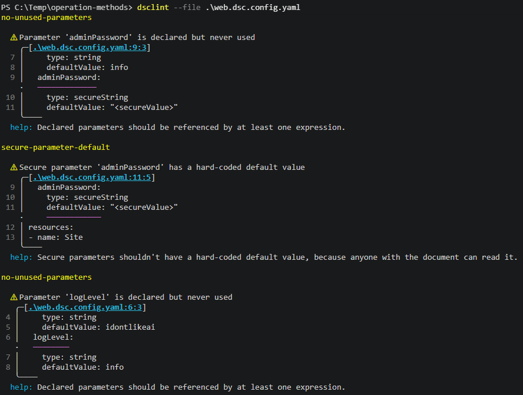

I've lost count of how many times a configuration failed on me for a reason I could have spotted by reading it. I only found it out when I ran it through DSC's engine.

When I worked with PowerShell DSC, compiling the configuration to a MOF file caught some of these mistakes for me. But Microsoft DSC doesn't have a compile step. You write YAML or JSON and give it to the engine. Simpler, yet it removed the one moment where something read your configuration before it does something to your machine.

I tried to bring that moment back. There's an official branch where you can use the new <code>dsclint</code> executable, which lints configuration documents. In this post, you'll look at how linting works in PowerShell DSC today, what Microsoft DSC gives you without a linter, and what <code>dsclint</code> adds.
<blockquote>

[!NOTE] 
As mentioned, <code>dsclint</code> is experimental and can be installed from a branch. Its rules, options, and output can change between releases.

</blockquote>
<h2 id="why-lint-a-configuration-document">Why lint a configuration document?</h2>
Linting is static analysis. A linter reads your code or document, compares it against a set of rules, and reports problems without running anything. Nothing changes on the machine, and nothing needs elevated permissions.

That matters for desired state configuration. A configuration document describes changes to a real system. Microsoft DSC already rejects some problems before it calls any resource, such as a document that fails the schema, a resource type that isn't installed, or a <code>dependsOn</code> that points at nothing. Other problems only surface when DSC reaches the resource that has them. A typo in an expression on the fifth resource fails after the first four have already run. Because DSC is idempotent, you can fix the document and run it again. But you've still changed a system with a document that was broken, and in a pipeline that's a failed deployment.

Many of the mistakes that cause those failures are visible in the document itself. An expression that calls a function that doesn't exist. A parameter that's declared but never used, which often means another expression has a typo. A secure parameter with a password typed into its default value. A linter finds these in seconds, before anything is applied.

<h2 id="how-linting-works-in-powershell-dsc">How linting works in PowerShell DSC</h2>
In PowerShell DSC, you author two kinds of things. You write <em>resources</em>, which are PowerShell modules with Get, Set, and Test logic. You also write <em>configurations</em>, which are PowerShell scripts that use the <code>Configuration</code> keyword and compile to MOF files. Each one gets checked in a different way.

For resources, the main tool is PSScriptAnalyzer. Besides its general PowerShell rules, it ships a set of rules for DSC resource authors.

<table>
<thead>
<tr>
<th>Rule</th>
<th>Severity</th>
<th>What it checks</th>
</tr>
</thead>
<tbody>
<tr>
<td>DSCStandardDSCFunctionsInResource</td>
<td>Error</td>
<td>The resource implements Get, Set, and Test</td>
</tr>
<tr>
<td>DSCUseIdenticalMandatoryParametersForDSC</td>
<td>Error</td>
<td>Key and Required properties in the MOF schema are mandatory parameters in all three functions</td>
</tr>
<tr>
<td>DSCUseIdenticalParametersForDSC</td>
<td>Error</td>
<td>Get, Set, and Test have identical parameters</td>
</tr>
<tr>
<td>DSCReturnCorrectTypesForDSCFunctions</td>
<td>Information</td>
<td>Get returns an object, Test returns a Boolean, and Set returns nothing</td>
</tr>
<tr>
<td>DSCUseVerboseMessageInDSCResource</td>
<td>Information</td>
<td>The resource writes verbose messages</td>
</tr>
<tr>
<td>DSCDscTestsPresent</td>
<td>Information</td>
<td>The module includes tests</td>
</tr>
<tr>
<td>DSCDscExamplesPresent</td>
<td>Information</td>
<td>The module includes examples</td>
</tr>
</tbody>
</table>

You run them like any other PSScriptAnalyzer rule. Point <code>Invoke-ScriptAnalyzer</code> at the folder that holds your resources.

<pre><code class="language-powershell">Invoke-ScriptAnalyzer -Path .\source\DSCResources -Recurse
</code></pre>

The DSC rules are always enabled. To skip one, exclude it in a PSScriptAnalyzer settings file or add a suppression attribute to the code. A few general rules matter just as much for DSC work, especially <code>AvoidUsingPlainTextForPassword</code> and <code>AvoidUsingConvertToSecureStringWithPlainText</code>.

The DSC Community builds on this. The <code>DscResource.AnalyzerRules</code> module adds custom rules that you load through the <code>CustomRulePath</code> setting. The <code>DscResource.Test</code> module runs the High Quality Resource Module (HQRM) tests with Pester, which cover style, file encoding, examples, and the PSScriptAnalyzer rules. The Sampler build pipeline wires all of this into CI for most community modules. If you remember <code>xDscResourceDesigner</code> and <code>Test-xDscResource</code>, those did a similar job and are now archived.

Configurations are a different story. There's no dedicated linter for them. A configuration is a PowerShell script, so the PowerShell parser catches syntax errors. Compiling the configuration catches more. The compile step fails when a resource isn't available through <code>Import-DscResource</code>, when a mandatory property is missing, or when two resource blocks of the same type share a name. It also refuses to write a plain-text credential to the MOF file unless the configuration data allows it with <code>PSDscAllowPlainTextPassword</code>.

Look at the following configuration. It declares the same <code>File</code> resource twice.

<pre><code class="language-powershell">Configuration Example {
    Import-DscResource -ModuleName PSDesiredStateConfiguration&#10;
    Node localhost {
        File Website {
            DestinationPath = 'C:\inetpub\wwwwroot\index.html'
            Contents        = 'Hello'
        }&#10;
        File Website {
            DestinationPath = 'C:\inetpub\wwwwroot\about.html'
            Contents        = 'About'
        }
    }
}&#10;
Example
</code></pre>

Running <code>Example</code> doesn't produce a MOF file. The compiler reports a duplicate resource identifier for <code>[File]Website</code> and stops.

This works, but it comes with conditions. Compilation needs PowerShell and every resource module the configuration imports, installed on the machine where you author or build. The errors come back as text, so a pipeline can tell that compilation failed but not why. Since PSDesiredStateConfiguration 2.0, Microsoft only supports configurations for use with Azure machine configuration.

In short, PowerShell DSC has strong tooling for resource code. Checks on configurations are a side effect of compilation, not a tool of their own.

<h2 id="validation-in-microsoft-dsc">Validation in Microsoft DSC</h2>
Microsoft DSC configuration documents are YAML or JSON, and DSC validates them against a JSON schema. That gives you a good editing experience out of the box. In VS Code, associate a YAML document with the enhanced authoring schema by adding a comment to the top of the file.

<pre><code class="language-yaml"># yaml-language-server: $schema=https://aka.ms/dsc/schemas/v3/bundled/config/document.vscode.json
</code></pre>

With that comment in place, you get IntelliSense, hover help, snippets, and clearer error messages while you type. To get the schema for a single resource's properties, run <code>dsc resource schema</code>.

<pre><code class="language-powershell">dsc resource schema --resource Microsoft/OSInfo
</code></pre>

A schema only checks structure, though. To a schema, <code>"[parameters('siteNmae')]"</code> is just a string, and a valid one. It can't tell you that no parameter with that name exists. It can't see that two resources depend on each other, or that a secure value flows into a plain output. Until now, you found those problems at runtime, with <code>dsc config test</code> or <code>dsc config set</code>.

<h2 id="introducing-dsclint">Introducing <code>dsclint</code></h2>
<code>dsclint</code> is a separate executable that ships with Microsoft DSC. It reads one or more configuration documents, runs a set of rules against them, and reports what it finds. It never calls a resource's set operation, so it's safe to run anywhere, including on a build agent.

Before you start, make sure you have:

<ul>
<li>The <a href="https://github.com/PowerShell/DSC/blob/main/docs/installing-nightly.md">dsclint</a> executable from the nightly build (branch <code>gh-591/main/add-dsc-lint-commnd</code>), extracted to a folder in your <code>PATH</code>.</li>
<li>The <code>dsc</code> executable and the resources your documents use, if you want the rules that check installed resources. Most rules don't need them.</li>
</ul>

Check that dsclint is available.

<pre><code class="language-powershell">dsclint --version
</code></pre>

You give dsclint a document in one of three ways. Use <code>--file</code> with a path, and repeat it to lint several documents in one run. Use <code>--file -</code> to read from STDIN. Use <code>--input</code> to pass the document as a string.

Every rule belongs to one of two tiers. <em>Static rules</em> only need the document. <em>Resource</em> rules need the installed resources, so dsclint runs resource discovery first, the same discovery <code>dsc</code> uses. Discovery is on by default. Use <code>--no-discovery</code> to run only the static rules, which is faster and works on a machine with no resources installed. When you lint a document for another machine, use <code>--system-root</code> to point discovery at that operating system root.

The rules fall into seven categories. To see them all with their levels, run <code>dsclint --list-rules</code>.

<table>
<thead>
<tr>
<th>Category</th>
<th>What it covers</th>
<th>Example rules</th>
</tr>
</thead>
<tbody>
<tr>
<td>Document</td>
<td>The shape of the document</td>
<td><code>duplicate-resource</code>, <code>duplicate-resource-name</code>, <code>empty-resources</code></td>
</tr>
<tr>
<td>Expression</td>
<td>Everything inside <code>[...]</code></td>
<td><code>invalid-expression</code>, <code>unknown-function</code>, <code>undefined-parameter</code></td>
</tr>
<tr>
<td>Parameter</td>
<td>Declarations and supplied values</td>
<td><code>no-unused-parameters</code>, <code>secure-parameter-default</code>, <code>missing-parameter-value</code></td>
</tr>
<tr>
<td>Dependency</td>
<td><code>dependsOn</code> and <code>reference()</code></td>
<td><code>unresolved-dependency</code>, <code>circular-dependency</code>, <code>reference-without-depends-on</code></td>
</tr>
<tr>
<td>Resource</td>
<td>Installed resource types</td>
<td><code>unknown-resource-type</code>, <code>property-schema-mismatch</code>, <code>exist-false-unsupported</code></td>
</tr>
<tr>
<td>Deprecation</td>
<td>Syntax on its way out</td>
<td><code>copy-loop-deprecated</code>, <code>security-context-in-metadata</code>, <code>dsc-version-unsatisfied</code></td>
</tr>
<tr>
<td>Environment</td>
<td>Portability across system roots</td>
<td><code>hardcoded-system-path</code>, <code>system-root-unused</code></td>
</tr>
</tbody>
</table>

Each rule reports at one of three levels: <code>error</code>, <code>warning</code>, or <code>info</code>. A rule can also be <code>off</code>. A few rules start out off, such as <code>use-parameter-description</code> and <code>missing-require-version</code>. Turn them on when your team wants that strictness. Four checks are fixed and you can't turn them off. They report:

<ol>
<li>When the document isn't valid JSON or YAML</li>
<li>When it fails the schema</li>
<li>When it isn't a configuration document</li>
<li>When resource discovery fails.</li>
</ol>

You control the run with two options. <code>--rule</code> changes the level of one rule, and you can repeat it. <code>--fail-on</code> sets the lowest level that makes <code>dsclint</code> exit with a failure. The default is <code>error</code>, so warnings show up in the report but don't fail the run.

<pre><code class="language-powershell">dsclint --file .\web.dsc.config.yaml --rule no-unused-parameters=off --fail-on warning
</code></pre>

If you come from PSScriptAnalyzer, this replaces the <code>IncludeRules</code>, <code>ExcludeRules</code>, and <code>Severity</code> settings, and you set it on the command line.

<h2 id="lint-a-document">Lint a document</h2>
Here's a document with four mistakes in it. Save it as <code>web.dsc.config.yaml</code>.

<pre><code class="language-yaml">$schema: https://aka.ms/dsc/schemas/v3/bundled/config/document.json
parameters:
  siteName:
    type: string
    defaultValue: idontlikeai
  logLevel:
    type: string
    defaultValue: info
  adminPassword:
    type: secureString
    defaultValue: P@ssw0rd!
resources:
- name: Site
  type: Microsoft.DSC.Debug/Echo
  properties:
    output: "[parameters('siteNmae')]"
- name: Admin
  type: Microsoft.DSC.Debug/Echo
  dependsOn:
  - "[resourceId('Microsoft.DSC.Debug/Echo', 'Website')]"
  properties:
    output: Admin account configured
</code></pre>

The <code>Site</code> resource has a typo in its parameter name. The <code>Admin</code> resource depends on a resource named <code>Website</code>, which doesn't exist. The <code>logLevel</code> parameter isn't used anywhere. And <code>adminPassword</code> is a secure parameter with the password typed into the document.

Run <code>dsclint</code> against the file.

<pre><code class="language-powershell">dsclint --file .\web.dsc.config.yaml
</code></pre>

In a terminal, <code>dsclint</code> shows each problem in place. You get the file name with line and column, a snippet of the document with the problem marked, and the rule's description as help text. At the end comes a count of errors, warnings, and info messages.

This run reports two errors and four warnings.

<table>
<thead>
<tr>
<th>Level</th>
<th>Rule</th>
<th>Line</th>
<th>Message</th>
</tr>
</thead>
<tbody>
<tr>
<td>error</td>
<td>undefined-parameter</td>
<td>16</td>
<td>Parameter 'siteNmae' isn't declared in 'parameters'</td>
</tr>
<tr>
<td>error</td>
<td>unresolved-dependency</td>
<td>20</td>
<td>Resource 'Admin' depends on 'Microsoft.DSC.Debug/Echo' named 'Website', which isn't declared</td>
</tr>
<tr>
<td>warning</td>
<td>no-unused-parameters</td>
<td>3</td>
<td>Parameter 'siteName' is declared but never used</td>
</tr>
<tr>
<td>warning</td>
<td>no-unused-parameters</td>
<td>6</td>
<td>Parameter 'logLevel' is declared but never used</td>
</tr>
<tr>
<td>warning</td>
<td>no-unused-parameters</td>
<td>9</td>
<td>Parameter 'adminPassword' is declared but never used</td>
</tr>
<tr>
<td>warning</td>
<td>secure-parameter-default</td>
<td>11</td>
<td>Secure parameter 'adminPassword' has a hard-coded default value</td>
</tr>
</tbody>
</table>

Notice the warning on line 3. You didn't plant that one. Because of the typo, nothing references <code>siteName</code>, so dsclint reports it as unused. Two diagnostics that point at each other are often one mistake. Fix the error first and the warning goes away.

<code>dsclint</code> exits with code <code>5</code> because it reported errors. Every exit code has one meaning, so a script or pipeline can tell what happened.

<table>
<thead>
<tr>
<th>Exit code</th>
<th>Meaning</th>
</tr>
</thead>
<tbody>
<tr>
<td>0</td>
<td>Nothing at or above the <code>--fail-on</code> level</td>
</tr>
<tr>
<td>1</td>
<td>Invalid arguments, such as an unknown rule name or no input</td>
</tr>
<tr>
<td>2</td>
<td>An unexpected DSC error</td>
</tr>
<tr>
<td>3</td>
<td>The result couldn't be serialized</td>
</tr>
<tr>
<td>4</td>
<td>A document or the parameters couldn't be read</td>
</tr>
<tr>
<td>5</td>
<td>A diagnostic at or above the <code>--fail-on</code> level was reported</td>
</tr>
</tbody>
</table>

Now fix the document. Correct the parameter name and the dependency. Remove <code>logLevel</code>. Remove the default value from <code>adminPassword</code> and use it in the <code>Admin</code> resource as a secure value.

<pre><code class="language-yaml">$schema: https://aka.ms/dsc/schemas/v3/bundled/config/document.json
parameters:
  siteName:
    type: string
    defaultValue: contoso
  adminPassword:
    type: secureString
resources:
- name: Site
  type: Microsoft.DSC.Debug/Echo
  properties:
    output: "[parameters('siteName')]"
- name: Admin
  type: Microsoft.DSC.Debug/Echo
  dependsOn:
  - "[resourceId('Microsoft.DSC.Debug/Echo', 'Site')]"
  properties:
    output:
      secureString: "[parameters('adminPassword')]"
</code></pre>

Run <code>dsclint</code> again. It reports no errors, no warnings, and no info messages, and it exits with code <code>0</code>.

Removing the default value has a side effect. <code>adminPassword</code> now needs a value at deployment time. <code>dsclint</code> can check the values you plan to deploy with, too. Create a parameters file named <code>params.json</code>. It uses the same format as <code>dsc config</code>, with the values under a top-level <code>parameters</code> key.

<pre><code class="language-json">{
  "parameters": {
    "adminPassword": "s3cret",
    "sitename": "idontlikeai"
  }
}
</code></pre>

Pass it with <code>--parameters-file</code>.

<pre><code class="language-powershell">dsclint --file .\web.dsc.config.yaml --parameters-file .\params.json
</code></pre>

<code>dsclint</code> reports an <code>undeclared-parameter-value</code> error. Parameter names are case-sensitive, and the document declares <code>siteName</code>, not <code>sitename</code>. Without the parameters file, this mistake would only show up when you apply the configuration. If you leave <code>adminPassword</code> out of the file, you get <code>missing-parameter-value</code> instead. You can also pass values inline with <code>--parameters</code>. When you use both, the inline values win.

<blockquote>

[!NOTE] 
With discovery enabled, <code>dsclint</code> can print trace warnings about the resources it finds on your machine, such as manifests that use an old schema URI. They come from discovery, not from your document. Add <code>--trace-level error</code> to hide them.

</blockquote>
<h2 id="read-the-result-as-data">Read the result as data</h2>
When you pipe dsclint's output or redirect it to a file, it writes JSON instead of the terminal report. Use <code>--output-format</code> to pick <code>json</code>, <code>pretty-json</code>, or <code>yaml</code> explicitly.

<pre><code class="language-powershell">dsclint --file .\web.dsc.config.yaml --output-format pretty-json
</code></pre>

Each diagnostic includes the level, the rule, the category, the message, the file, the line and column, and a JSON pointer to the exact spot in the document.

<pre><code class="language-json">{
  "level": "error",
  "rule": "undefined-parameter",
  "category": "expression",
  "message": "Parameter 'siteNmae' isn't declared in 'parameters'",
  "path": "/resources/0/properties/output",
  "file": "web.dsc.yaml",
  "location": {
    "line": 16,
    "column": 5
  }
}
</code></pre>

The result ends with a summary of the counts, a <code>valid</code> flag, and a <code>discovery</code> flag that tells you whether the resource rules ran. That makes the output easy to work with in PowerShell.

<pre><code class="language-powershell">$result = dsclint --file .\web.dsc.config.yaml | ConvertFrom-Json
$result.diagnostics | Where-Object level -eq 'error' | Format-Table rule, message
</code></pre>

One more detail matters here. <code>dsclint</code> never prints a secret. When it shows a snippet of your document, it replaces secure values with <code>&lt;secureValue&gt;</code>. That includes defaults on secure parameters and values in <code>secureString</code> and <code>secureObject</code> properties. You can paste the report into an issue or a pull request without leaking anything.

<h2 id="run-dsclint-in-a-pipeline">Run <code>dsclint</code> in a pipeline</h2>
<code>dsclint</code> is most useful when it runs on every change. The exit codes make that easy. Here's a GitHub Actions step that lints every configuration document in the repository and fails the build on any warning. It assumes dsclint is already on the runner's <code>PATH</code>.

<pre><code class="language-yaml">- name: Lint DSC configuration documents
  shell: pwsh
  run: |
    $documents = Get-ChildItem -Recurse -Include '*.dsc.yaml', '*.dsc.config.yaml'
    $fileArgs = $documents | ForEach-Object { '--file', $_.FullName }
    dsclint @fileArgs --no-discovery --fail-on warning
</code></pre>

The step uses <code>--no-discovery</code> because a build agent usually doesn't have your resources installed. If yours does, drop the option to get the resource rules as well, such as <code>unknown-resource-type</code> and <code>property-schema-mismatch</code>.

<h2 id="side-by-side-comparison">Side-by-side comparison</h2>
The two approaches lint different things. That's the biggest difference between them.

<table>
<thead>
<tr>
<th></th>
<th>PowerShell DSC</th>
<th>Microsoft DSC with dsclint</th>
</tr>
</thead>
<tbody>
<tr>
<td>What gets linted</td>
<td>Mostly resource code</td>
<td>Configuration documents</td>
</tr>
<tr>
<td>Tools</td>
<td>PSScriptAnalyzer, DscResource.Test</td>
<td>dsclint</td>
</tr>
<tr>
<td>Configuration checks</td>
<td>A side effect of compiling to MOF</td>
<td>Dedicated rules (might change in the future for a plugin model)</td>
</tr>
<tr>
<td>What you need installed</td>
<td>PowerShell plus every imported resource module</td>
<td>The dsclint executable, plus resources only for the resource rules</td>
</tr>
<tr>
<td>Expressions</td>
<td>Not applicable, configurations are PowerShell</td>
<td>Parsed and checked</td>
</tr>
<tr>
<td>Secrets</td>
<td>Rules for plain-text passwords in code</td>
<td>Rules for secure defaults and secure outputs, and redacted reports</td>
</tr>
<tr>
<td>Rule settings</td>
<td>Settings file and suppression attributes</td>
<td><code>--rule</code> and <code>--fail-on</code> on the command line</td>
</tr>
<tr>
<td>Output</td>
<td>PowerShell objects</td>
<td>Terminal report, JSON, or YAML</td>
</tr>
<tr>
<td>Platforms</td>
<td>Windows first</td>
<td>Windows, Linux, and macOS</td>
</tr>
</tbody>
</table>

The gap runs in both directions. <code>dsclint</code> lints configuration documents only. It doesn't lint resource manifests yet, and it doesn't look at resource code. If you call PowerShell resources through the PowerShell adapter, keep running PSScriptAnalyzer on those modules. The two tools work well together. PSScriptAnalyzer checks the resources, and dsclint checks the documents that use them.

<h2 id="where-to-go-next">Where to go next</h2>
<code>dsclint</code> is still <a href="https://github.com/PowerShell/DSC/pull/1768">open for review</a>, so you can expect rule names, default levels, and output to change before it's stable. But you can have influence on the design. There's an <a href="https://github.com/PowerShell/DSC/pull/1766">open RFC in the GitHub repository</a> where you can leave your feedback.

