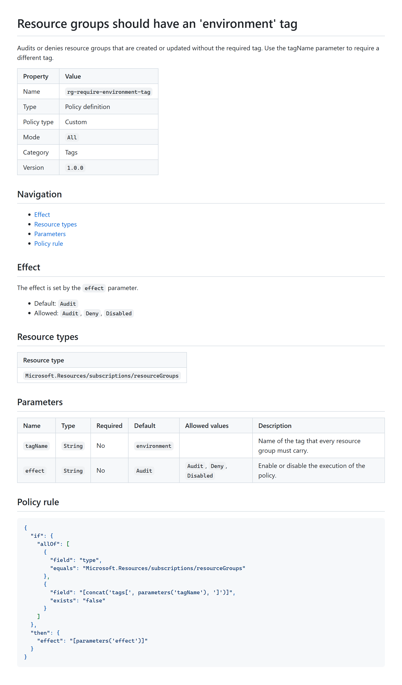
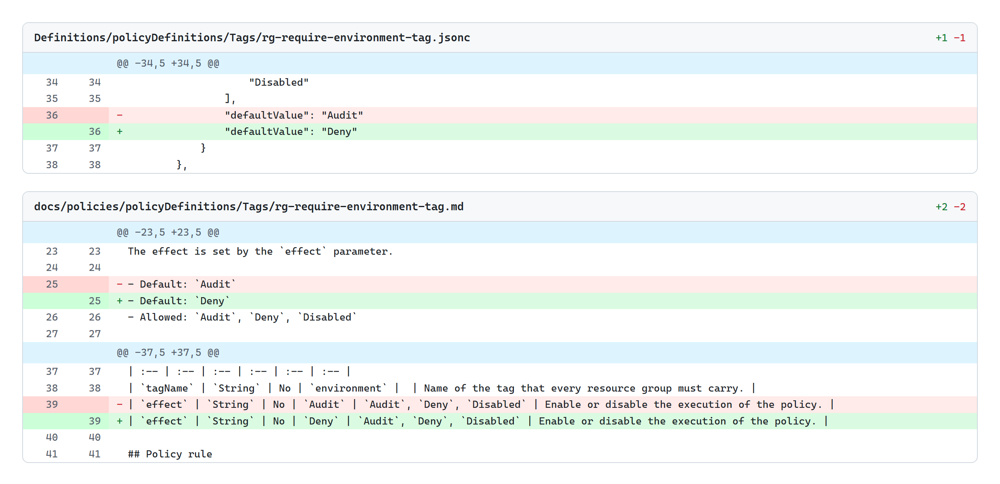
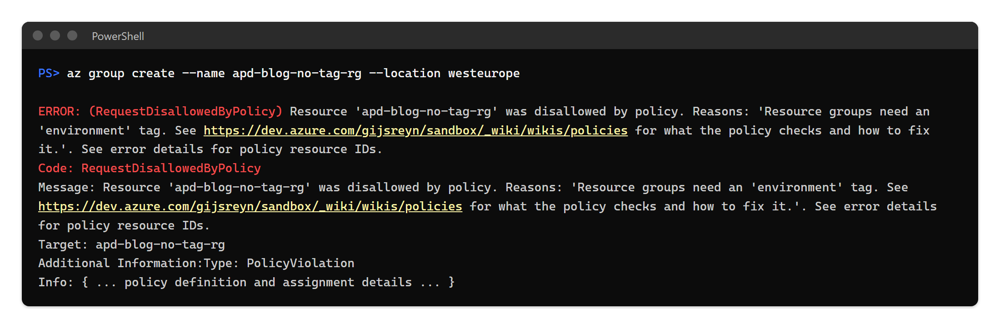

When a deployment is denied, the team opens the policy to find out why. What they find is a <code>policyRule</code> full of nested <code>allOf</code> and <code>count</code> blocks. For the policy engine, that's the documentation. For them, it isn't. They want to know which effect applies, which parameter changes it, and what the policy looks at.

I built a tool for this for three reasons. First, I was building an EPAC pipeline, and I like documentation that the pipeline enforces. I want to say when a page is out of date, which should make the build fail. Second, I'd started using the new <code>docs</code> command in Bicep and wanted the same thing for policy: one command, one page per file. Third, our platform engineering team maintains a large set of platform documentation that we go through. Every page has to be current by then, and a policy page that someone updates by hand is one more thing to remember.

EPAC already ships a documentation script, <code>Build-PolicyDocumentation</code>. It reports your assignments per environment and compares policy sets for overlapping policies and effects, in Markdown, CSV, or an Azure DevOps wiki. It answers <em>what's assigned where</em>. It doesn't produce a page for each policy definition that explains the rule, the parameters, and the permissions a remediation needs.

This article uses <code>azurepolicydocs</code>, a .NET tool I wrote that reads the same policy files EPAC deploys and renders a Markdown page for each one:

You generate a page for one policy, then for every definition in the repository, and build a catalog that links to all of them. Then you adjust the template, check the pages on every pull request, and link them from the error a denied developer actually sees.

If you followed <a href="/how-to-version-azure-policy-releases-with-epac-and-semantic-release/">How to version Azure Policy releases with EPAC and semantic-release</a>, this is also where the <code>docs/</code> folder in every release package comes from.

<h2 id="prerequisites">Prerequisites</h2>

Before you begin, make sure you have:

<ul>
<li>The <a href="https://dotnet.microsoft.com/download/dotnet/10.0">.NET 10 SDK</a> or later.</li>
<li>An EPAC repository. The one from the <a href="/how-to-version-azure-policy-releases-with-epac-and-semantic-release/">previous article</a> works, but any repository with a <code>Definitions/policyDefinitions</code> folder will do.</li>
<li><a href="https://learn.microsoft.com/powershell/scripting/install/installing-powershell">PowerShell 7</a> for the examples. The commands work in any shell; only the line continuation character differs.</li>
<li>For the pipeline and wiki sections: an Azure DevOps project with a Git repository. Only the release section needs the release pipeline from the previous article.</li>
</ul>

The tool reads local files. It doesn't sign in to Azure or call any Azure API.

The examples were tested with:

<ul>
<li>.NET SDK 10.0.404</li>
<li>AzurePolicyDocs.Cli 1.0.1</li>
<li>PowerShell 7.7</li>
</ul>
<h2 id="install-the-tool">Install the tool</h2>

You can install <code>azurepolicydocs</code> globally or as a local tool in the repository. A global install is fine for trying it out. For a repository that a pipeline builds, use a local tool so the version is recorded in Git.

From the root of your EPAC repository, create a tool manifest and install the tool:

<pre><code class="language-powershell">dotnet new tool-manifest
dotnet tool install AzurePolicyDocs.Cli
</code></pre>

This creates <code>.config/dotnet-tools.json</code> with the exact version you installed. Commit it. Anyone who clones the repository, including the pipeline agent, runs <code>dotnet tool restore</code> and gets the same version. It's the same reason <code>package.json</code> pinned exact versions in the previous article: the version that generated the documentation is part of the commit.

Skip <code>dotnet new tool-manifest</code> if the repository already has a manifest.

Verify the installation:

<pre><code class="language-powershell">dotnet azurepolicydocs --version
</code></pre>

The command should print the version from the manifest. The rest of this article writes the command as <code>azurepolicydocs</code>, as you'd type it after a global install. With a local install, prefix it with <code>dotnet</code>.

<h2 id="generate-a-page-for-one-policy">Generate a page for one policy</h2>

Start with a single definition. Download <a href="https://github.com/Gijsreyn/azure-policy-docs/blob/main/samples/policyDefinitions/rg-require-environment-tag.jsonc">rg-require-environment-tag.jsonc</a> from the tool's repository and save it as <code>Definitions/policyDefinitions/Tags/rg-require-environment-tag.jsonc</code>. The parts that end up on the page are the <code>effect</code> parameter and the rule:

<pre><code class="language-jsonc">{
    "name": "rg-require-environment-tag",
    "type": "Microsoft.Authorization/policyDefinitions",
    "properties": {
        "displayName": "Resource groups should have an 'environment' tag",
        // mode, description, metadata, and the tagName parameter are left out here.
        "parameters": {
            "effect": {
                "type": "String",
                "allowedValues": ["Audit", "Deny", "Disabled"],
                "defaultValue": "Audit"
            }
        },
        "policyRule": {
            "if": {
                "allOf": [
                    {
                        "field": "type",
                        "equals": "Microsoft.Resources/subscriptions/resourceGroups"
                    },
                    {
                        // tags[...] is a dynamic field reference, so the tag name can come from a parameter.
                        "field": "[concat('tags[', parameters('tagName'), ']')]",
                        "exists": "false"
                    }
                ]
            },
            "then": {
                "effect": "[parameters('effect')]"
            }
        }
    }
}
</code></pre>

Preview the page without writing a file:

<pre><code class="language-powershell">azurepolicydocs generate ./Definitions/policyDefinitions/Tags/rg-require-environment-tag.jsonc --stdout
</code></pre>

The page starts with the display name as the heading, then the description, then a table with the name, policy type, mode, category, and version. Below that are sections for the effect, the targeted resource types, the parameters, and the full policy rule.

The effect section is the one the application team reads first:

<pre><code class="language-markdown">## Effect&#10;
The effect is set by the `effect` parameter.&#10;
- Default: `Audit`
- Allowed: `Audit`, `Deny`, `Disabled`
</code></pre>

The tool recognizes three ways a rule can set its effect. A fixed value such as <code>"deny"</code> is shown as is. A parameter reference, as in this policy, is shown with the parameter name, its default, and its allowed values. An expression, such as an <code>if()</code> that picks between two effects, is summarized by the effect names it contains. The expression itself is always visible in the policy rule section.

The resource types table lists <code>Microsoft.Resources/subscriptions/resourceGroups</code>, taken from the <code>type</code> condition. The <code>tags[...]</code> field isn't listed as a field alias. Tag references aren't aliases, so the page leaves them out.

Run the same command without <code>--stdout</code>:

<pre><code class="language-powershell">azurepolicydocs generate ./Definitions/policyDefinitions/Tags/rg-require-environment-tag.jsonc
</code></pre>

Without an output option, the tool writes <code>rg-require-environment-tag.md</code> beside the input. That's convenient for one file, but it mixes generated Markdown into the folder EPAC reads. Delete the file. For a whole repository, write the pages to a separate folder.

<h2 id="understand-what-the-tool-reads">Understand what the tool reads</h2>

Before you point the tool at a whole repository, it helps to know which files it accepts. It reads policy definitions and policy set definitions in the shapes you'll find in real repositories:

<table>
<thead>
<tr>
<th style="text-align:left">Input</th>
<th style="text-align:left">Where it comes from</th>
</tr>
</thead>
<tbody>
<tr>
<td style="text-align:left">A full resource payload with <code>name</code>, <code>type</code>, and <code>properties</code></td>
<td style="text-align:left">EPAC, exports from Azure, and the <code>Azure/azure-policy</code> repository</td>
</tr>
<tr>
<td style="text-align:left">Only the property bag (<code>displayName</code>, <code>policyRule</code>, and so on)</td>
<td style="text-align:left">Repositories that drop the wrapper. The name falls back to the file name.</td>
</tr>
<tr>
<td style="text-align:left"><code>.jsonc</code> files with comments and trailing commas</td>
<td style="text-align:left">EPAC</td>
</tr>
<tr>
<td style="text-align:left">Policy sets that reference members by <code>policyDefinitionName</code></td>
<td style="text-align:left">EPAC</td>
</tr>
</tbody>
</table>

Property names are matched case-insensitively, because exported files don't agree on casing.

The parser isn't strict, and that's deliberate. The tool documents the files you have. It doesn't judge whether they're correct. Validation is the job of the Azure Policy Linter from <a href="/how-to-lint-azure-policy-definitions-in-azure-devops-with-epac-and-azure-policy-linter/">How to lint Azure Policy definitions in Azure DevOps with EPAC and Azure Policy Linter</a>.

The parser does stop on two things: a file that isn't valid JSON, and a file that's neither a policy definition nor a policy set definition. The second one matters in an EPAC repository, as the next section shows.

<h2 id="generate-pages-for-every-definition">Generate pages for every definition</h2>

The <code>--pattern</code> option takes a glob and generates a page for every matching file. The obvious pattern for an EPAC repository is <code>./Definitions/**/*.json*</code>. It fails.

<code>Definitions/</code> also holds <code>global-settings.jsonc</code> and the files under <code>policyAssignments/</code>. Neither is a policy definition. The tool reports each one on stderr with the message <code>is not a policy definition or a policy set definition</code>, still writes the pages for the files that did parse, and exits with 1.

Match only the two definition folders instead:

<pre><code class="language-powershell">azurepolicydocs generate --pattern "./Definitions/policy*Definitions/**/*.json*" --outdir ./docs/policies
</code></pre>

<code>policy*Definitions</code> matches <code>policyDefinitions</code> and <code>policySetDefinitions</code>. It doesn't match <code>policyAssignments</code> or <code>policyExemptions</code>, and <code>global-settings.jsonc</code> sits outside the matched folders.

The tool takes the longest literal directory before the first wildcard as the pattern root, here <code>Definitions</code>. Everything below the root is recreated under <code>--outdir</code>, so two files with the same name in different folders don't overwrite each other:

<pre><code class="language-text">docs/policies/
├── policyDefinitions/
│   ├── General/
│   │   └── allowed-locations.md
│   └── Tags/
│       ├── resources-inherit-rg-tag-dynamic-notscope.md
│       └── rg-require-environment-tag.md
└── policySetDefinitions/
    └── allowed-locations-initiative.md
</code></pre>

Every output path is worked out and checked before the first file is written. An output can't overwrite its input, can't end in <code>.json</code> or <code>.jsonc</code>, and two inputs can't write to the same file. A conflict stops the run before anything on disk changes.

<blockquote>

[!IMPORTANT] 
Quote the pattern. On Linux and macOS, PowerShell <a href="https://learn.microsoft.com/powershell/scripting/whats-new/unix-support">expands wildcards in unquoted arguments to native commands</a>. The tool then receives a list of files instead of a pattern and stops with <code>The input file and the --pattern parameter cannot both be specified.</code> Quote it when it's in a variable too (<code>--pattern "$pattern"</code>), as the pipeline template does. The same error is in the troubleshooting table of the previous article.

</blockquote>
<h2 id="document-a-remediation-policy">Document a remediation policy</h2>

A page for an <code>audit</code> or <code>deny</code> policy answers what the policy blocks. A page for a <code>modify</code> or <code>deployIfNotExists</code> policy also has to answer what the policy changes, and with which permissions.

The <code>resources-inherit-rg-tag-dynamic-notscope</code> definition in the tree above copies a tag from the resource group to the resources in it. Its effect section looks like this:

<pre><code class="language-markdown">## Effect&#10;
The effect is set by the `effect` parameter.&#10;
- Default: `Modify`
- Allowed: `Disabled`, `Audit`, `Deny`, `Modify`&#10;
Remediation needs these role assignments:&#10;
| Role | Role definition ID |
| :-- | :-- |
| Contributor | `b24988ac-6180-42a0-ab88-20f7382dd24c` |&#10;
Modify operations:&#10;
| Operation | Field |
| :-- | :-- |
| `addOrReplace` | `[concat('tags[', parameters('tagName'), ']')]` |
</code></pre>

The role comes from <code>roleDefinitionIds</code> in the rule. Common built-in roles get their name. Other roles show only the GUID. For a <code>deployIfNotExists</code> policy, the section also names the related resource type and states whether the rule has an existence condition and a deployment.

This matters during review. A pull request that adds a remediation policy with <code>Owner</code> shows <code>Owner</code> on the generated page, in plain text, without anyone opening the JSON.

The same page also shows the limits of the summary. Its resource types section says the policy rule has no explicit <code>type</code> condition, even though the rule compares <code>type</code> inside a <code>count</code> expression.

<h2 id="understand-what-the-page-doesnt-show">Understand what the page doesn't show</h2>

A resource type is listed only when the rule compares the <code>type</code> field directly under <code>if</code>, with <code>equals</code>, <code>in</code>, <code>like</code>, <code>match</code>, <code>matchInsensitively</code>, or <code>contains</code>. Expressions are skipped. In the inherit-tag policy, <code>type</code> is compared against <code>current('excludedResourceTypes')</code>, a list of types the policy <em>skips</em>. Listing those as targets would be wrong, so the page lists nothing.

You might expect the tool to derive resource types from field aliases instead. It can't do that reliably. An alias such as <code>Microsoft.Storage/storageAccounts/supportsHttpsTrafficOnly</code> joins a resource type and a property path into one string, and nothing marks where one ends. Counting slashes doesn't help, because <code>Microsoft.Sql/servers/databases</code> is a type with three segments. Only the resource provider metadata in Azure has the answer, and the tool doesn't call Azure. Aliases are listed separately, exactly as they're written in the rule.

Both lists are a quick overview, not the source of truth. The full policy rule is always at the bottom of the page.

The tool also doesn't document policy assignments or exemptions. EPAC assignment files use their own tree format. That means a page tells you what a policy <em>can</em> do. Which scope it's assigned to, and with which parameter values, is still in <code>policyAssignments/</code>.

<h2 id="build-a-catalog-page">Build a catalog page</h2>

Individual pages are useful once you know which policy to look for. The catalog is the page you link to so people can find out.

Generate the catalog with the same pattern you used for the pages:

<pre><code class="language-powershell">azurepolicydocs catalog --pattern "./Definitions/policy*Definitions/**/*.json*" `
    --outfile ./docs/policies/README.md `
    --docs-dir ./docs/policies `
    --custom-template-value "title=Platform policies" `
    --custom-template-value "description=Policies maintained by the platform team."
</code></pre>

<code>--docs-dir</code> tells the catalog where <code>generate --outdir</code> wrote the pages. Without it, the links point to a <code>.md</code> file beside each source file, which doesn't exist when you generated into a separate folder. The catalog doesn't create the pages itself, so run <code>generate</code> first.

The catalog lists policy definitions and policy sets in separate tables, sorted by category and then by display name:

<pre><code class="language-markdown">| Policy | Category | Mode | Effects | Description |
| :-- | :-- | :-- | :-- | :-- |
| [Resources should be deployed to allowed locations](policyDefinitions/General/allowed-locations.md) | General | `Indexed` | `Audit`, `Deny`, `Disabled` | Audits or denies resources deployed outside the allowed locations. ... |
| [Inherit Tag from Resource Group with dynamic notScope](policyDefinitions/Tags/resources-inherit-rg-tag-dynamic-notscope.md) | Tags | `Indexed` | `Disabled`, `Audit`, `Deny`, `Modify` | Resources inherit a tag from the resource group. ... |
</code></pre>

The Effects column is the one people scan. It shows which policies can deny a deployment without opening any of them.

<h2 id="customize-the-template">Customize the template</h2>

The built-in templates are a reasonable default. Most teams want to add something, such as who owns the policies and where to request an exemption.

Export the two built-in templates to a <code>templates</code> folder:

<pre><code class="language-powershell">azurepolicydocs template export --kind policyDefinition --outfile ./templates/_policy.scriban
azurepolicydocs template export --kind policySetDefinition --outfile ./templates/_policy-set.scriban
</code></pre>

A <code>generate</code> run uses one template for every input. Your pattern matches both policy definitions and policy sets, so the template you pass has to handle both. Save the following as <code>templates/policy.scriban</code>. It picks the right built-in template for each input and adds an ownership section to every page:

<pre><code class="language-scriban">{{~ if policy.kind == "policySetDefinition" ~}}
{{~ include "_policy-set.scriban" ~}}
{{~ else ~}}
{{~ include "_policy.scriban" ~}}
{{~ end ~}}
{{~ if custom.owner ~}}&#10;
## Ownership&#10;
- Owner: {{ custom.owner }}
{{~ if custom.supportUrl ~}}
- Exemption requests: &lt;{{ custom.supportUrl }}&gt;
{{~ end ~}}
{{~ end ~}}
</code></pre>

Scriban prints everything outside <code>{{ }}</code> as is, including the line break after a tag. The <code>~</code> in <code>{{~</code> and <code>~}}</code> removes the whitespace on that side. Putting every control statement on its own line with both markers, and writing blank lines explicitly, keeps the output predictable.

Values in <code>custom</code> are strings that you pass on the command line. Keep them in a file next to the template. Save the following as <code>templates/values.json</code>:

<pre><code class="language-jsonc">{
    // Example: not really a website
  "owner": "Platform team",
  "supportUrl": "https://idontlikeai.dev/platform/exemptions"
}
</code></pre>

Generate the pages with the custom template:

<pre><code class="language-powershell">azurepolicydocs generate --pattern "./Definitions/policy*Definitions/**/*.json*" `
    --outdir ./docs/policies `
    --template ./templates/policy.scriban `
    --include-root ./templates `
    --custom-template-value-file-path ./templates/values.json
</code></pre>

<code>include</code> statements resolve against the input file's folder by default. <code>--include-root</code> points them at the <code>templates</code> folder instead. Every page now ends with an Ownership section, and policy set pages still use the policy set layout.

A template that fails to parse stops the run before any file is written, and the error names the line and column. A template that fails while rendering one input reports that input and continues with the others. In both cases, the exit code is 1 and existing pages are left as they were.

<blockquote>

[!NOTE] 
The names a template reads, such as <code>policy.displayName</code> or <code>effect.defaultEffect</code>, are the tool's public interface. Renaming one is a breaking change for every custom template. That's another reason to pin the tool version in the manifest. An update that renames a key arrives as a major version, and you choose when to take it.

</blockquote>
<h2 id="check-the-documentation-on-pull-requests">Check the documentation on pull requests</h2>

So far, the pages exist on your machine. They stay accurate only if they're regenerated every time a definition changes, and the only place that's guaranteed is the pipeline.

The template below generates the pages and the catalog, then runs in one of two modes. <code>check</code> fails when the committed documentation is out of date. <code>commit</code> regenerates the documentation and pushes it; the release section later in this article uses it. Save the template as <code>pipelines/templates/policy-docs.yml</code>:

<pre><code class="language-yaml">parameters:
  - name: mode
    type: string
    default: check
    values:
      - check
      - commit&#10;
steps:
  - task: UseDotNet@2
    displayName: Install .NET 10 SDK
    inputs:
      packageType: sdk
      version: 10.0.x&#10;
  - pwsh: dotnet tool restore
    displayName: Restore local tools&#10;
  - pwsh: |
      $pattern = './Definitions/policy*Definitions/**/*.json*'&#10;
      dotnet azurepolicydocs generate --pattern "$pattern" `
        --outdir ./docs/policies `
        --template ./templates/policy.scriban `
        --include-root ./templates `
        --custom-template-value-file-path ./templates/values.json
      if ($LASTEXITCODE -ne 0) { exit $LASTEXITCODE }&#10;
      dotnet azurepolicydocs catalog --pattern "$pattern" `
        --outfile ./docs/policies/README.md `
        --docs-dir ./docs/policies `
        --custom-template-value "title=Platform policies"
      exit $LASTEXITCODE
    displayName: Generate policy documentation&#10;
  - ${{ if eq(parameters.mode, 'check') }}:
      - pwsh: |
          $changes = git status --porcelain -- docs
          if ($changes) {
            Write-Host '##vso[task.logissue type=error]Policy documentation is out of date. Regenerate it and commit the result.'
            $changes
            exit 1
          }
        displayName: Check that documentation is current&#10;
  - ${{ if eq(parameters.mode, 'commit') }}:
      - pwsh: |
          git add docs
          git diff --cached --quiet
          if ($LASTEXITCODE -eq 0) {
            Write-Host 'Documentation is current.'
            exit 0
          }
          git -c user.name='Azure Pipelines' -c user.email='azure-pipelines@devopsagent.com' `
            commit -m 'docs: regenerate policy documentation [skip ci]'
          git push origin HEAD:$(Build.SourceBranchName)
        displayName: Commit regenerated documentation
</code></pre>

The check uses <code>git status --porcelain</code> instead of <code>git diff --exit-code</code>. A new policy produces a new page, and <code>git diff</code> doesn't report untracked files.

The check only works because the output is deterministic. Every page uses <code>\n</code> line endings, ends with exactly one newline, and is written as UTF-8 without a byte order mark. A page generated on a Windows laptop is byte-for-byte the same as one generated on a Linux agent, so the check fails only when a policy or template actually changed.

To run the check, save the following as <code>pipelines/policy-docs-check.yml</code>:

<pre><code class="language-yaml">trigger: none&#10;
pool:
  vmImage: ubuntu-latest&#10;
steps:
  - checkout: self&#10;
  - template: templates/policy-docs.yml
    parameters:
      mode: check
</code></pre>

Create a pipeline from this file, then add it as a build validation policy on <code>main</code>. In Azure Repos, branch policies trigger pull request builds, not the YAML file. If you already have a pull request pipeline, add only the <code>template</code> step to it.

With the check in place, a pull request that changes a policy must include its regenerated page. Reviewers then see the change in plain language. A diff that turns <code>Default: Audit</code> into <code>Default: Deny</code> is easier to catch than the same change in a parameter block.

<h2 id="commit-the-documentation-before-a-release">Commit the documentation before a release</h2>

This section is for readers of <a href="/how-to-version-azure-policy-releases-with-epac-and-semantic-release/">How to version Azure Policy releases with EPAC and semantic-release</a>. If you don't release with semantic-release, skip to the next section.

In that article, the <code>Release</code> job runs the template with <code>mode: commit</code> as its first step, before semantic-release:

<pre><code class="language-yaml">- template: templates/policy-docs.yml
  parameters:
    mode: commit
</code></pre>

The order is deliberate. semantic-release <a href="https://github.com/semantic-release/semantic-release/blob/master/index.js">refuses to release</a> when the remote branch is ahead of the commit it runs on. It logs <code>The local branch main is behind the remote one, therefore a new version won't be published.</code> and exits without an error, so the pipeline stays green while nothing is released. Committing the documentation first means semantic-release tags the commit that already contains the docs, and the package for that version carries them.

Two details make the commit work:

<ul>
<li>The commit uses the <code>docs</code> type, which doesn't trigger a release under the rules from the previous article, and <code>[skip ci]</code> so the push doesn't start another run.</li>
<li>The push needs the checkout step to keep its credentials (<code>persistCredentials: true</code>), and the build service needs the Contribute and Bypass policies permissions you already granted for semantic-release.</li>
</ul>

A diff that turns <code>Default: Audit</code> into <code>Default: Deny</code> is also exactly the change that calls for a <code>feat!</code> commit under that article's rules.

If you'd rather not ask contributors to run the tool locally, leave the pull request check out and let <code>commit</code> mode regenerate the docs on <code>main</code>. You lose the review diff, but the package still ships accurate documentation.

<h2 id="put-the-page-where-the-denied-developer-looks">Put the page where the denied developer looks</h2>

A page in <code>docs/policies</code> or inside a release package doesn't help the developer whose deployment was just denied. They see an error in the portal, the Azure CLI, or their pipeline log, and that's where the link has to be. Two steps get it there.

First, give the pages a URL. In Azure DevOps, go to <strong>Wiki</strong>, select <strong>Publish code as wiki</strong>, and pick your repository, the <code>main</code> branch, and the <code>docs/policies</code> folder. The head of the branch is mapped to the wiki, so every commit that changes a page updates the wiki without another pipeline step. The catalog appears as the <code>README</code> page.

Second, put the page URL in the assignment's non-compliance message. Azure Policy shows that message in the deny error and on the resource's compliance results. In an EPAC assignment file, add <code>nonComplianceMessages</code> to the assignment:

<pre><code class="language-jsonc">"nonComplianceMessages": [
    {
        "message": "Resource groups need an 'environment' tag. See https://dev.azure.com/contoso/platform/_wiki/wikis/policies for what the policy checks and how to fix it."
    }
]
</code></pre>

For an assignment of a policy set, add <code>policyDefinitionReferenceId</code> to each message to link each member policy to its own page.

<h2 id="troubleshoot">Troubleshoot</h2>

Most of these come from running the tool against a real EPAC repository for the first time.

<table>
<thead>
<tr>
<th style="text-align:left">Symptom</th>
<th style="text-align:left">Cause</th>
<th style="text-align:left">Fix</th>
</tr>
</thead>
<tbody>
<tr>
<td style="text-align:left"><code>is not a policy definition or a policy set definition</code> for <code>global-settings.jsonc</code> or an assignment file</td>
<td style="text-align:left">The pattern matches all of <code>Definitions/</code></td>
<td style="text-align:left">Use <code>./Definitions/policy*Definitions/**/*.json*</code></td>
</tr>
<tr>
<td style="text-align:left"><code>The pattern root directory "..." does not exist.</code></td>
<td style="text-align:left">A typo in the literal part of the pattern, or the command runs from a different folder</td>
<td style="text-align:left">Fix the path, or run the command from the repository root</td>
</tr>
<tr>
<td style="text-align:left">The command exits with 0 but writes nothing</td>
<td style="text-align:left">The part of the pattern after the root matches no files. The tool prints <code>No files matched the pattern</code> on stderr and returns 0.</td>
<td style="text-align:left">Check the file extension in the pattern</td>
</tr>
<tr>
<td style="text-align:left"><code>The input file and the --pattern parameter cannot both be specified.</code></td>
<td style="text-align:left">PowerShell on Linux expanded an unquoted wildcard</td>
<td style="text-align:left">Quote the pattern, including when it's in a variable: <code>--pattern "$pattern"</code></td>
</tr>
<tr>
<td style="text-align:left">Catalog links return 404</td>
<td style="text-align:left">The catalog ran without <code>--docs-dir</code> after <code>generate --outdir</code></td>
<td style="text-align:left">Pass the same folder to <code>--docs-dir</code></td>
</tr>
<tr>
<td style="text-align:left">Policy set pages are missing their member tables</td>
<td style="text-align:left">A policy definition template rendered a policy set</td>
<td style="text-align:left">Branch on <code>policy.kind</code>, as in <code>templates/policy.scriban</code></td>
</tr>
<tr>
<td style="text-align:left"><code>Failed to parse the documentation template</code></td>
<td style="text-align:left">A Scriban syntax error, such as an <code>if</code> without <code>end</code></td>
<td style="text-align:left">Fix the line and column in the message. No files were written.</td>
</tr>
<tr>
<td style="text-align:left">The check fails on a pull request</td>
<td style="text-align:left">A definition changed without its page</td>
<td style="text-align:left">Run the generate and catalog commands locally and commit <code>docs/</code></td>
</tr>
<tr>
<td style="text-align:left">The push in <code>commit</code> mode is rejected</td>
<td style="text-align:left">Missing permissions or credentials</td>
<td style="text-align:left">Set <code>persistCredentials: true</code> on the checkout and check the build service permissions from the previous article</td>
</tr>
</tbody>
</table>
<h2 id="documentation-as-code-is-more-than-generated-markdown">Documentation as code is more than generated Markdown</h2>

Generating Markdown from JSON is the easy part. What makes the page worth reading is where it comes from. It's rebuilt from the same file EPAC deploys, in the same commit, and shipped in the same package as the version number semantic-release assigned. When someone asks what version 1.4.0 of the baseline did, the answer is in the package for 1.4.0.

A hand-written wiki page is a promise that someone will update it. A generated page doesn't depend on anyone remembering, and a pipeline check enforces it.

<h2 id="clean-up">Clean up</h2>

If you only tried the tool locally, remove it and the generated files.

Uninstall the local tool, which also removes it from the manifest:

<pre><code class="language-powershell">dotnet tool uninstall AzurePolicyDocs.Cli
</code></pre>

For a global install, add <code>--global</code>. Then delete <code>docs/policies</code> and <code>templates</code>. If you added <code>policy-docs.yml</code> to a pipeline, remove the template reference and the build validation policy as well. If you published <code>docs/policies</code> as a wiki, unpublish it, and remove the link from any <code>nonComplianceMessages</code>.

<h2 id="where-to-go-next">Where to go next</h2>

You now generate a page for every policy definition and policy set, a catalog that links to them, and a custom section on every page. A pull request can't change a policy without its page, and a denied deployment links straight to the page that explains it.

The next step is the one the previous article ended with: splitting the pipeline so deployments come straight from the Azure Artifacts feed. Once the documentation is in the package, the docs for the version running in production are the docs in that version's package, not whatever is on <code>main</code> today.

If Markdown files in a repository aren't where your team reads documentation, the <code>AzurePolicyDocs.Core</code> NuGet package exposes the same parser, model, and renderer to your own .NET code. A custom template can also render HTML, AsciiDoc, or CSV. With <code>--pattern</code> and <code>--outdir</code>, the tool still names every output <code>.md</code>, so use <code>--outfile</code> for a single file in another format, or call <code>AzurePolicyDocs.Core</code> to choose the file names yourself.

